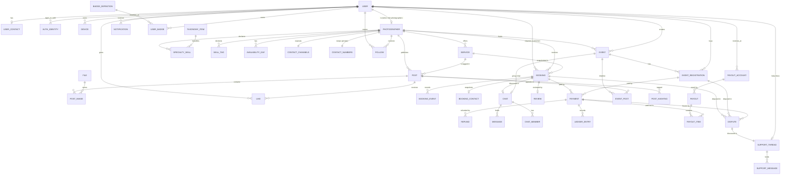

# Mô hình miền

Thực thể, đối tượng giá trị, quan hệ và danh mục enum của hệ thống, **độc lập với nơi lưu trữ**. Quy chuẩn kiểu ở [README.md](README.md) mục 2; bảng lưu trữ ở [relational-schema.md](relational-schema.md). Mã lớp bằng Dart (bất biến, freezed) ở `lib/domain/`; máy chủ dùng cùng tên khái niệm.

## 1. Đối tượng giá trị (value objects)

Bất biến, so sánh theo giá trị, tự kiểm tra hợp lệ khi tạo. Không có danh tính riêng.

| Đối tượng | Trường | Quy tắc |
|-----------|--------|---------|
| `Id<T>` | `value: String` | 1–64 ký tự `[A-Za-z0-9_-]`; không so sánh giữa kiểu `T` khác nhau |
| `Instant` | `utc: DateTime` | Luôn UTC; JSON ISO‑8601 `Z` |
| `LocalDate` | `y, m, d` | Ngày theo múi giờ Asia/Ho_Chi_Minh; JSON `yyyy-MM-dd` |
| `LocalTime` | `h, m` | `HH:mm`, bội số 5 phút trong giao diện, lưu phút |
| `Money` | `amount: int`, `currency: String = 'VND'` | `amount ≥ 0`; phép cộng cùng tiền tệ; `percent(30)` làm tròn xuống |
| `GeoPoint` | `lat: double`, `lng: double` | `-90..90`, `-180..180`; sinh `geohash(precision)` |
| `PhoneNumber` | `e164: String` | Chuẩn hoá `+84…`; kiểm `^(?:\+84\|0)(3\|5\|7\|8\|9)\d{8}$` cho số VN; quốc tế `^\+\d{8,15}$`; `masked()` trả `0903 ••• 456` |
| `FileRef` | `fileId: Id<File>` | Tham chiếu tới `File`; URL dựng lúc chạy |
| `Verdict` | `tomato` \| `brick` | thay `Rating` 1..5 (2026-10-06) |
| `ReviewSubjectType` | `photographer` \| `studio` | đối tượng của một đánh giá; #130 ghi `photographer`, #136 ghi thêm `studio` cho booking studio |
| `AssigneeKind` | `member` \| `collaborator` | thợ được giao một booking studio; `collaborator` (S27, #151) thêm không cần migrate, chỉ là "thợ đã nhận" khi `Booking.assigneeAccepted = true` |
| `FeeHint` | `{type: per_shoot, amount: Money}` \| `{type: negotiable}` | thù lao tham khảo của tin tuyển (S27); `amount` 1.000–100.000.000₫, bội số 1.000 (cũng là luật của `agreedFee`, `defaultFee`) |
| `RecruitDaily` | `day: LocalDate` (giờ VN), `count: int` | đếm thao tác trong một ngày VN; `RecruitNoticeDaily` thêm `postIds` để chạy lại fan-out không đếm hai lần |
| `RelationStatus` | `invited`, `requested`, `active`, `declined`, `cancelled`, `expired`, `left`, `removed` | trạng thái `StudioRelation`; mở = `invited`, `requested`, `active` |
| `StudioFaultKind` | `assign_overdue`, `change_declined`, `change_expired`, `late_reassign` | lý do khách được huỷ hoàn 100% (`BookingCancel.by = studio_fault`) |
| `StudioBrickReason` | `late_assignment`, `slow_response`, `price_changed`, `poor_assignment`, `other` | lý do gạch cho khối đánh giá studio |
| `ReviewReason` | `late` \| `not_as_portfolio` \| `slow_delivery` \| `attitude` \| `price_changed` \| `other` | lý do gạch |
| `TicketCode` | `value: String` | `VE-XXXX-MMDD`, duy nhất; chữ in hoa không có `0/O/1/I` |
| `Percent` | `value: int` | 0..100 |
| `DateRange`, `TimeRange` | `start, end` | `start < end` |
| `Reason` | `code: ReasonCode`, `text: String` | Lý do gợi ý |

## 2. Thực thể

Ký hiệu: **PK** khoá chính, **FK** khoá ngoại, `?` có thể rỗng, `🔒` dữ liệu nhạy cảm (tách bảng riêng).

### 2.1 Tài khoản và hồ sơ

| Thực thể | Trường chính | Ghi chú |
|----------|--------------|---------|
| `User` | `id` PK, `displayName`, `avatar: FileRef?`, `role: UserRole?`, `staffRole: StaffRole?`, `city?`, `locale = 'vi'`, `accountStatus: AccountStatus?` (`active`, `deletion_pending`), `restoreUntil: Instant?`, `createdAt`, `updatedAt`, `deletedAt?` | `role = null` cho tới khi chọn ở màn chọn vai trò; `staffRole` chỉ do admin đặt; `accountStatus` = `deletion_pending` khi yêu cầu xoá, khoá tài khoản trong 30 ngày (#205) |
| `AccountDeletion` | `uid` PK, `status: AccountDeletionStatus` (`pending`, `restored`, `purging`, `done`, `blocked`), `requestedAt: Instant`, `restoreUntil: Instant`, `done: [string]` (các bước đã chạy xong), `createdAt: Instant`, `updatedAt: Instant` | Bản ghi yêu cầu xoá tài khoản (#205). Cửa sổ khôi phục 30 ngày (`pending` → `restoreUntil = requestedAt + 30d`). Chỉ server ghi/đọc |
| `UserContact` 🔒 | `userId` PK/FK, `phone: PhoneNumber`, `phoneVerified = false`, `allowZalo = true`, `allowWhatsApp = false`, `updatedAt` | Số điện thoại khách; không nằm trong `User` (công khai) |
| `AuthIdentity` 🔒 | `id` PK, `userId` FK, `provider: AuthProvider`, `subject`, `email?`, `createdAt` | `(provider, subject)` duy nhất; cho phép đổi IdP |
| `Device` 🔒 | `id` PK (Firestore: `{uid}_{installId}`, `installId` sinh một lần cho mỗi lần cài), `userId` FK, `provider: PushProvider`, `token`, `platform`, `lastSeenAt` | Thay `users.fcmTokens` |
| `File` | `id` PK, `ownerUserId` FK, `storageProvider`, `storageKey`, `mimeType`, `sizeBytes`, `width?`, `height?`, `blurhash?`, `createdAt` | Mọi ảnh/tệp |

### 2.2 Nhiếp ảnh gia

| Thực thể | Trường chính | Ghi chú |
|----------|--------------|---------|
| `Photographer` | `userId` PK/FK, `bio`, `yearsExperience`, `serviceArea: {city, center: GeoPoint, radiusKm}`, `cover: FileRef?`, `verified = false`, `verifiedAt?`, `onboardingComplete = false`, `acceptsInquiries = true`, `hiddenFromDiscovery = false`, `deletionPending = false`, `followerCount = 0`, `followerCountAt?`, `stats: PhotographerStats` | `stats` do dịch vụ tính; `followerCount` dẫn xuất từ `Follow` (server-only trigger recount, #143); `hiddenFromDiscovery` do thợ ảnh bật/tắt (S22.03) để ẩn khỏi gợi ý và tìm kiếm; `deletionPending` do máy chủ gán khi yêu cầu xoá tài khoản (#205) |
| `PhotographerStats` | `tomatoCount`, `brickCount`, `tomatoPct: int`, `score: double (−1..1)`, `reviewCount`, `completedCount`, `responseMinutesMedian?`, `startingPrice: Money?`, `nextFreeDate?`, `skillsCompleteness`, `skillsCompletenessNext?` (mã bước còn thiếu đầu tiên), `skillsCompletenessNextAfter?` (điểm sau bước đó), `skillsEvidenceRemovedAt?` (lần Function gỡ minh chứng gần nhất) | Giá trị dẫn xuất, ghi bởi use case. Bất biến: `stats.reviewCount` luôn dùng thay cho `stats.rating`. `startingPrice` do `onServiceWrite` ghi; `completedCount` do `onBookingWrite` ghi; `nextFreeDate` tính từ `availability` (hướng sự kiện + rollover 00:10 hằng ngày). `catalog/explore` lưu tổng số gói hoạt động và ảnh bìa theo thể loại chuyên môn (#132). |
| `ContactChannels` | `photographerId` PK/FK, `call`, `zalo`, `whatsapp` | Công khai (cờ) |
| `ContactNumbers` 🔒 | `photographerId` PK/FK, `phone`, `zaloPhone?`, `whatsappPhone?` | Không lộ ra khỏi use case `get_contact_link` |
| `Service` (gói) | `id` PK, `photographerId` FK, `name`, `specialtyId?`, `durationMinutes`, `price: Money` (> 0), `photoCount`, `editedCount`, `deliveryDays`, `cover?`, `active` | |
| `ServiceAddon` (dịch vụ đi kèm) | `id` PK, `providerId` FK, `kind: AddonKind`, `name` (2–60), `description?` (≤ 200), `price: Money` (10.000–50.000.000), `unit: AddonUnit`, `maxQty` (1–10; `per_booking` luôn 1), `serviceIds: List<Id<Service>>` (≤ 20; rỗng = mọi gói), `active`, `createdAt`, `updatedAt` | Chỉ server ghi (`saveAddon`, `deleteAddon`); không chứa số điện thoại, email, link |
| `SpecialtySkill` | `photographerId`, `specialtyId`, `level: SkillLevel (1..3)`, `years?`, `evidence: List<Id<Post>>` | Tối đa 6 thể loại, 3 mức 3 |
| `SkillTag` | `photographerId`, `group: SkillGroup`, `itemId` | style, extra, language, audience |
| `TaxonomyItem` | `id` PK (mã), `group`, `labelVi`, `parentId?`, `sortOrder`, `active` | Danh mục thể loại, phong cách, kỹ năng, ngôn ngữ, đối tượng, khu vực |
| `AvailabilityDay` | `photographerId`, `day: LocalDate`, `state: DayState`, `bookingId?`, `eventId?` | PK `(photographerId, day)`; không có bản ghi = rảnh |

### 2.3 Nội dung

| Thực thể | Trường chính | Ghi chú |
|----------|--------------|---------|
| `Post` | `id` PK, `authorId` FK, `kind: PostKind` (`work`, `real_shoot`, `event_share`), `photographerId` FK, `serviceId` FK, `bookingId?`, `caption`, `location: {name, point, geohash}`, `styleId?`, `specialty?` (= `specialtyId` của dịch vụ, phi chuẩn hoá), `hashtags` (chữ thường, không dấu `#`), `inPortfolio`, `likeCount`, `saveCount`, `createdAt`, `deletedAt?` | `serviceId` bắt buộc |
| `PostImage` | `postId`, `position`, `file: FileRef` | 1–10 ảnh; ánh xạ từ `imageMeta[]` (`blurHash`, `w`, `h`) → `post_images` |
| `PostHashtag` | `postId`, `tag` (chữ thường, không dấu `#`) | PK ghép; trích từ chú thích khi ghi bài |
| `Like`, `Save` | `userId`, `postId`, `createdAt` | PK ghép; đếm là dẫn xuất |
| `SavedPhotographer` | `userId`, `photographerId`, `createdAt` | PK ghép; marker Firestore `savedPhotographers/{userId}_{photographerId}` (#143) |
| `Follow` | `followerId`, `photographerId`, `createdAt` | PK ghép; marker Firestore `userId` ↔ `follower_id` |

### 2.4 Đặt lịch và thanh toán

| Thực thể | Trường chính | Ghi chú |
|----------|--------------|---------|
| `Booking` | `id` PK, `customerId`, `photographerId`, `serviceId`, `serviceSnapshot: {name, price: Money, durationMinutes}`, `day: LocalDate`, `start: LocalTime`, `end: LocalTime`, `place: {name, point?}`, `note?`, `addons?: List<AddonLine>` (chỉ khi có; `AddonLine` = `{addonId, kind, name, unit, unitPrice: Money, qty, amount: Money}`, bản chụp lúc đặt, tối đa 10 dòng, sắp theo thứ tự `kind` rồi thứ tự chọn), `pickup?: {name, point?}` (chỉ khi có dịch vụ `transport`; chỉ nằm trong `bookings/{id}`), `status: BookingStatus`, `deliveryRound?`, `revisionsIncluded?`, `deliveryDays?: int` (bản chụp số ngày bàn giao từ gói lúc đặt, 1–90, mặc định 7; #207), `deliveryCancel?: {at: Instant, dueAt: Instant, refundedAmount: Money}` (đặt khi khách huỷ phần bàn giao sau `shotAt + deliveryDays`; #207), `extraRound?: ExtraRound`, `shotAt?: Instant`, `deliveredAt?: Instant`, `approvedAt?: Instant`, `autoApproveAt?: Instant`, `checkUntil?: Instant`, `completedAt?: Instant`, `deposit: Money`, `remaining: Money`, `depositProvider?`, `depositPaidAt?`, `depositRefundedAt?`, `checkout?: BookingCheckout` (chỉ `draft`), `payableUntil?: Instant` (chỉ `draft`), `acceptDeadline?: Instant`, `cancel?: {by, reason, at, refundPercent}`, `refundAccountNeeded = false` (#141), `chatId?`, `reviewedAt?` (server ghi khi `submitReview` thành công; `status` không đổi), `source?: BookingSource` (`package` \| `quote` \| `instant` \| `spot` \| `spot_slot`), `spotId?`, `spotScheduleId?`, `slotOfferId?`, `assigneeId?`, `assigneeKind?: AssigneeKind`, `assignedAt?: Instant`, `version`, `createdAt`, `updatedAt` | Snapshot gói tại thời điểm đặt. Từ #129 khách trả **100%**: `deposit` giữ **toàn bộ tổng** (= `serviceSnapshot.price` + Σ `addons.amount`, #190) và `remaining` luôn 0. Bàn giao hai lớp (#152): bổ sung 4 trạng thái (`shot`, `delivered`, `revision_requested`, `approved`), trường vòng sửa `deliveryRound`, `revisionsIncluded`, `extraRound`, các mốc thời gian `shotAt`, `deliveredAt`, `approvedAt`, `autoApproveAt` (tự động duyệt sau 72h), `checkUntil` (48h sau approved), `completedAt`. Huỷ phần bàn giao khi trễ hạn (#207): `deliveryDays` chụp từ `deliverables.deliveryDays` (hoặc `terms.deliveryDays`), `deliveryCancel` ghi khi khách kết thúc phần bàn giao quá hạn (booking sang `completed`, mốc `delivery` hoàn 100%). `BookingCheckout` = `{paymentId, method: PaymentMethod, amount: Money, expiresAt: Instant, transferCode, attempt, qrPayload?, bankName?, accountMasked?, payUrl?, bankAppsUrl?}`: bản sao do `createPayment` ghi để app vẽ QR hoặc mở ví mà không đọc `payments`; số tài khoản thu hộ chỉ lưu dạng che. `payableUntil` = `createdAt + 30 phút`, đẩy lên `expiresAt + 5 phút` mỗi khi tạo khoản; job dọn xoá `draft` quá hạn này. `refundAccountNeeded` (chỉ server ghi, #141): bật khi huỷ/từ chối/hết hạn tạo lệnh hoàn `awaiting_account` (khoản QR), tắt trong cùng giao dịch đưa lệnh hoàn sang `pending` (khách chọn ở S22.04 hoặc mặc định 24 giờ); app dùng để hiện thẻ "Bạn được hoàn …" ở S05.02. Lệnh hoàn của `booking_payment_paths` (`late_payment_draft_expired`, `provider_not_accepting`) gửi ngay về tài khoản người chuyển; thiếu tài khoản thì chờ mà không bật cờ (không có booking để hiện), chỉ hiện ở S22.01 |
| `BookingEvent` | `id` PK, `bookingId`, `status`, `at: Instant`, `actorId?` | Dòng thời gian (thay `timeline[]`) |
| `BookingContact` 🔒 | `bookingId` PK/FK, `name`, `phone`, `allowZalo`, `allowWhatsApp`, `redactedAt?` | Chụp lúc yêu cầu (lưu tại `bookings/{id}/private/contact`); xoá số ngay khi huỷ/từ chối hoặc sau 30 ngày completed |
| `Payment` | `id` PK, `subjectType: PaymentSubject` (`booking`, `event_registration`, `instant_request`, `verification_fee`), `subjectId`, `payerId` (khách trả), `payeeId?` (nhiếp ảnh gia hoặc chủ sự kiện nhận tiền), `provider: PaymentProvider`, `method?: PaymentMethod`, `amount: Money`, `status: PaymentStatus`, `transferCode?` (`PB XXXXXX`), `expiresAt?: Instant`, `receivedAmount?: Money` (tổng đã tính vào `amount`; thiếu thì cộng dồn), `instructions?: PaymentInstructions` (bản sao hướng dẫn thanh toán cho client), `payer?: StoredBankAccount` (mã hoá, lưu ngân hàng, 4 số cuối và tên chủ tk người chuyển đầu tiên, #201), `refundedAmount?: Money` (tổng số tiền đã hoàn trên payment, #201), `escrowStatus: EscrowStatus`, `releasedAt?`, `releaseAfter?`, `dispute?: PaymentDispute` (`{reason, openedAt, disputeId?, milestone?: MilestoneKind \| null, prevEscrowStatus?: held \| partially_refunded}`, của khiếu nại gần nhất: `openDispute` ghi đè khi mở khiếu nại thứ hai trên mốc kia; giữ lại sau khi có kết quả; lịch sử đầy đủ ở `disputes`; chỉ máy chủ đọc; mục 2.15), `payoutId?` (bản sao Firestore của lô đang mở; quan hệ: join `payout_items`, xoá khi lô `failed`), `providerRef?`, `raw?: json`, `idempotencyKey`, `eventId?` (vé: sự kiện của đăng ký, để đóng dấu `releaseAfter` và tìm khoản hoàn khi huỷ sự kiện), `createdAt`, `updatedAt` | Dùng cho thanh toán 100% của mọi chủ thể (booking, vé sự kiện, Chụp ngay, phí xác minh; #200); `escrowStatus` theo dõi tiền treo (khoản `expired` ghi `refunded`: không có gì để giữ). `method`, `transferCode`, `expiresAt`, `receivedAmount`, `instructions`, `payer`, `refundedAmount` dùng chung cho mọi chủ thể. Mã chuyển khoản: `"PB "` + 6 ký tự từ bảng `23456789ABCDEFGHJKMNPQRSTVWXYZ` (bỏ 0/O/1/I/L/U) suy ra từ id khoản bằng băm FNV-1a 32 bit, **duy nhất trên mọi khoản** (không riêng khoản đang mở); khi trùng thì sinh lại id, tối đa 3 lần |
| `LedgerEntry` | `id` PK, `type: LedgerEntryType`, `paymentId?`, `refundId?`, `payoutId?`, `subjectType?`, `subjectId?`, `accountOwnerId?`, `amount: Money` (có dấu), `note?`, `at: Instant` | **Bất biến, chỉ thêm**; số dư treo/chờ chi trả suy ra từ tổng |
| `PayoutAccount` 🔒 | `id` PK, `userId` FK, `bankCode`, `accountNumberEnc`, `accountLast4`, `holderName` (tên ngân hàng trả về, hoặc tên đã xác minh khi ngân hàng không tra được), `nameStatus: NameStatus`, `activeFrom: Instant`, `active`, `createdAt`, `deactivatedAt?` | Tài khoản nhận tiền; số được mã hoá; đổi tài khoản giữ bản cũ với `active = false`. Tài khoản đầu có `activeFrom = createdAt`; tài khoản đổi có `activeFrom = createdAt + 72 giờ` và chưa nhận tiền trước đó (`isAccountActiveAt`). Bản ghi cũ đọc `nameStatus = matched`, `activeFrom = createdAt` |
| `Payout` | `id` PK, `payeeId` FK, `amount: Money` (**tổng gộp** của các khoản), `platformFee: Money` (hoa hồng), `taxWithheld: Money` (thuế khấu trừ), `amountNet: Money` (= `amount` − `platformFee` − `taxWithheld`; số thật sự chuyển), `feeRateBp: int`, `taxRateBp: int` (tỉ lệ đã dùng, ghi lại để lịch sử không đổi khi chính sách đổi; 700 = 7%), `firstPayout: bool` (chưa có lô nào của tài khoản này được duyệt hay đã chi), `status: PayoutStatus`, `accountId` FK, `reference?`, `idempotencyKey` (= id lô), `provider` (`fake` cho tới khi có tổ chức trung gian), `createdAt`, `scheduledAt?`, `paidAt?`, `failureReason?`, `holdReason?` (`repeated_failure` khi 3 lô cuối của tài khoản đều `failed`), `createdBy` FK (nhân viên hoặc `system:createPayouts`), `items: PayoutItem[]` (Firestore nhúng; quan hệ: bảng `payout_items`), `approvedBy?`, `approvedAt?` | Lô chi trả cho một người nhận. `status = needs_approval` khi là lô đầu tới tài khoản (chưa có lô nào của tài khoản đó đã `paid` hay đã được duyệt và đang `pending`/`processing`; lô `failed` không tính) hoặc tài khoản `pending_review`; ngoại lệ `on_hold` khi 3 lô đã xong gần nhất của tài khoản đều `failed`; staff duyệt một lần cho mỗi tài khoản (`approvePayout`). Bản ghi cũ đọc phí 0, thuế 0, `amountNet = amount`, `firstPayout = false` |
| `EarningItem` / `EarningsSummary` (đọc, S06.05) | `EarningItem`: `id` = `paymentId`, `payeeId`, `subjectType`, `subjectId`, `counterpartName`, `subjectLabel`, `day`, `amount: Money` (gộp, đã trừ hoàn tiền), `platformFee`, `taxWithheld`, `netAmount: Money`, `feeRateBp`, `taxRateBp`, `estimated: bool` (true tới khi khoản được chuyển: số lấy từ chính sách; false: số của `PayoutItem`), `milestonesDone?`, `milestonesTotal?` (đọc từ `bookings/{id}/milestones`; chưa có thì bỏ trống), `state: EarningState`, `holdReason?` (mã cố định, không phải chữ của khách), `paidOutAt?`, `updatedAt`. `EarningsSummary`: `payeeId`, `heldAmount`, `soonAmount`, `receivedAmount`, `lastPayout?`, `updatedAt` | **Hình chiếu** tính bởi `earningsOf`/`refresh_earnings` từ `Payment`, `Refund`, `Payout`; không phải bảng (máy chủ riêng tính bằng SQL) |
| `PayerPaymentRow` / `PayerTotals` (đọc, S22.01, #141) | `PayerPaymentRow`: `paymentId` (= id tài liệu), `payerId`, `subjectType`, `subjectId`, `eventId?`, phần tiêu đề `photographerName?`, `serviceName?`, `eventTitle?`, `quantity?`, `areaLabel?`, `day?: LocalDate` (ngày chụp/sự kiện), `method?: PaymentMethod`, `amount: Money` (số khách đã chuyển, kể cả chuyển thừa/trễ), `status: PayerRowStatus`, `open: bool`, `toPlatform: bool` (người nhận là nền tảng: phí S21, sự kiện nền tảng), `heldAmount`, `refundingAmount`, `refundedAmount`, `searching`, `cancelled`, `refunds: List<PayerRefundView>` (`refundId`, `amount`, `status`, `method`, `kind: policy \| excess` theo `fromEscrow`, `destinationLabel?` "Vietcombank •••• 6789", `createdAt`, `doneAt?`), `createdAt`, `paidAt?`, `updatedAt`. `PayerTotals`: `held`, `refunding` (tổng trên các dòng `open`) | **Hình chiếu** do `payerRowOf`/`refreshPayerHistory` tính từ `Payment`, `Refund` và chủ thể (Firestore `users/{uid}/payments/{paymentId}`, `users/{uid}/private/paymentTotals`; chỉ chủ tài khoản đọc, chỉ server ghi; danh sách trường cố định nên không bao giờ chứa `payer`, `candidate`, số tài khoản mã hoá hay mã của cổng). Có dòng khi khoản đã từng nhận tiền (đã trả, `receivedAmount > 0` hoặc có lệnh hoàn). Tiêu đề do app ghép (không lưu chữ tiếng Việt). Máy chủ riêng: view trên `payments`/`refunds` |
| `PayoutItem` | `payoutId`, `paymentId`, `amount: Money` (gộp), `fee: Money`, `tax: Money`, `net: Money` | Khoản nào nằm trong lô nào; PK ghép. Phí và thuế tính **trên từng khoản** bằng `Math.round(amount × bp / 10000)` (`payoutLineOf`, chính sách `DEFAULT_PAYOUT_POLICY`: hoa hồng 0 cho mọi loại, thuế 5% GTGT + 2% TNCN = 7% cho `individual` và `artist`, 0 cho `studio`); `net = amount − fee − tax`, tổng của lô là tổng các khoản nên từng dòng ở S06.05 cộng ra đúng |
| `OtpChallenge` 🔒 | `uid` FK, `purpose: 'payout_account'`, `codeHash`, `salt`, `targetHash` (băm có muối của `salt:bankCode:số` của tài khoản mới sắp lưu), `expiresAt`, `attempts`, `sentAt`, `sendDay` (yyyy-MM-dd giờ Việt Nam), `sendsToday`, `consumedAt?` | Mã xác nhận khi đổi tài khoản nhận tiền: 6 số, hiệu lực 5 phút, sai 5 lần phải gửi lại, gửi lại sau 60 giây, tối đa 5 lần mỗi ngày; chỉ lưu băm có muối của mã (không lưu mã, không lưu số tài khoản), dùng một lần, gắn với một tài khoản. Chỉ máy chủ đọc/ghi (Firestore `otp_challenges/{uid}_payout_account`; quan hệ: bảng `otp_challenges`, khoá `(user_id, purpose)`); **không** đặt dưới `users/{uid}/private/` vì quy tắc ở đó cho chủ đọc mọi tài liệu. Cùng chỗ: hạn mức tra tên `payout_lookups/{uid}` `{day, count}` (20 lần mỗi ngày, cũng chỉ máy chủ) |
| `Refund` | `id` PK, `paymentId` FK, `subjectType: PaymentSubject`, `amount: Money`, `percent`, `status: RefundStatus`, `method: RefundMethod`, `destination?: RefundDestination` (tài khoản nhận hoàn, mã hoá, `source: 'payer' | 'customer'`), `confirmBy?: Instant` (hạn xác nhận tài khoản hoàn, #141: `createdAt + 24 giờ` khi chờ và có tài khoản người chuyển; rỗng khi không có, hoặc khi mặc định 24 giờ không gửi được), `candidate?: StoredBankAccount` (tài khoản khác khách đã tra tên ở S22.04, mã hoá; xoá khi lệnh hoàn rời `awaiting_account`; #141), `accountLookups?: {day, count}` (số lần tra tên trong một ngày giờ Việt Nam, tối đa 20 mỗi lệnh hoàn; #141), `attempts: int` (số lần đã gọi cổng/chi hộ), `lastAttemptAt?: Instant`, `failureReason?`, `manual`, `fromEscrow` (true: tiền lấy ra từ ký quỹ — huỷ, từ chối, tranh chấp, khoản trả khi bản nháp đã mất; false: tiền trả lại ngay khi nhận, chưa từng vào ký quỹ — `overpaid_excess`, `extra_transfer`, `late_transfer`, `underpaid_expired`; giải ngân, chi trả và thu nhập chỉ trừ hoàn có `fromEscrow`; bản ghi cũ thiếu trường coi là true; không bao giờ suy ra từ `reason`), `reason?` (`overpaid_excess`, `underpaid_expired`, `late_transfer`, `extra_transfer`, `duplicate_verification_fee` và `stale_verification_fee` của phí xác minh, cùng các lý do huỷ/từ chối cũ), `providerRef?`, `createdAt`, `updatedAt` | `id` là khoá chống trùng gửi sang cổng (gửi lại cùng id không hoàn hai lần). #201 bổ sung `method`, `destination`, `confirmBy`, `attempts`, `lastAttemptAt`, `failureReason`. #141 đặt `confirmBy` và thêm `candidate`, `accountLookups` (cả ba chỉ server đọc); `destination.source = customer` khi khách chọn tài khoản đã tra. |
| `PaymentNotification` 🔒 | `id` PK = `{provider}_{txnId}`, `provider`, `txnId` (mã giao dịch của tổ chức trung gian), `raw` (nội dung gốc, chuỗi), `receivedAt: Instant` (UTC), `outcome: TransferOutcome` (trừ `duplicate`), `paymentId?` | Khoá chống trùng của webhook: ghi cùng giao dịch với khoản, bút toán và lệnh hoàn, nên webhook gửi lại hoặc job đối soát gặp lại là không làm gì. Lưu `payer` chỉ trong `raw`. Client không đọc được; chỉ máy chủ ghi |
| `Review` | `id` PK = `reviewDocId(bookingId, subjectType)` (`bookingId` với `photographer`, `{bookingId}_studio` với `studio`), `bookingId` FK, `subjectType: ReviewSubjectType` (`photographer` \| `studio`), `subjectId` (tài khoản mà đánh giá cộng vào `stats`), `photographerId` (= `subjectId`, để truy vấn tab Đánh giá), `customerId`, `serviceId`, `serviceName` (ảnh chụp của gói), `bookingDay` (`yyyy-MM-dd`, ảnh chụp của booking), `verdict: Verdict`, `hits: int (1..10)`, `intensity: double` (server tính từ `hits`: `round2(0,4 + 0,6·log10(hits))`), `reasons: ReviewReason[]`, `text`, `photoPostId?`, `createdAt`, `countedAt?` (server) | Một đánh giá cho mỗi đối tượng trong một booking; không có `rating`. Doc sao cũ không có `verdict` đọc như `tomato` khi `rating ≥ 4`, ngược lại `brick` (chỉ hiển thị) |

### 2.5 Trò chuyện và thông báo

| Thực thể | Trường chính | Ghi chú |
|----------|--------------|---------|
| `Chat` | `id` PK, `kind: ChatKind` (`inquiry`, `booking`, `collab`, `event_group`), `bookingId?` (duy nhất khi có), `eventId?` (duy nhất khi `event_group`), `jobId?`, `startedBy?: 'customer' | 'photographer'`, `customerId?`, `photographerId?` (rỗng với nhóm), `assigneeId?` (nhân viên hỗ trợ, chat hỏi trước của sự kiện nền tảng), `moderatorsOnly = false`, `photographerRepliedAt?`, `lastMessageAt?`, `lastMessagePreview?`, `bookingStatus?: BookingStatus` (read model: bản sao `Booking.status` của `bookingId`, máy chủ ghi mỗi lần booking đổi trạng thái kể cả `upcoming` và `reviewed`; null với `inquiry`; nguồn sự thật vẫn là `Booking.status`), `blockedAt?: Instant` (khi hai bên đã chặn nhau; chat đóng không gửi được tin) | `inquiry` → thành `booking` khi gắn `bookingId`; chat `booking` hết hạn chỉ đọc → thành `inquiry` lại khi khách mở "Nhắn tin hỏi trước" (`bookingId`, `bookingStatus`, `readOnlyAt` xoá); `photographerRepliedAt != null` gỡ giới hạn 3 tin; "đã đóng" của `inquiry` được tính (`lastMessageAt ?? createdAt` + 14 ngày), không lưu; `jobId` liên kết hội thoại với việc đăng tuyển |
| `ChatMember` | `chatId`, `userId`, `role: ChatMemberRole`, `mutedUntil?`, `unreadCount`, `lastReadAt?`, `joinedAt`, `removedAt?` | Thành viên nhóm sự kiện có vai `member`/`moderator` |
| `ChatPin` | `chatId`, `messageId`, `pinnedBy`, `pinnedAt` | Tin ghim (thông báo của chủ sự kiện) |
| `Message` | `id` PK, `chatId`, `senderId?`, `type: MessageType`, `body?`, `file?`, `point?`, `createdAt`, `deletedAt?` | `system` không có người gửi |
| `Notification` | `id` PK (xác định: `n_{dedupeKey}` hoặc `g_{groupKey}`), `userId`, `type: NotificationType`, `tab: NotificationTab`, `category: NotificationCategory`, `title`, `body` (server dựng, tiếng Việt), `target` (đường dẫn app), `groupKey?`, `actors?: [{id, name, avatarUrl?}]` (≤ 3), `count`, `thumbUrl?`, `lastEventId?`, `recentEventIds: [string]` (dòng gộp: 20 mã sự kiện gần nhất, mới nhất trước; trùng trong danh sách = bản trùng), `readAt?`, `createdAt` | Hộp thư S17.01. Số chưa đọc **không** nằm trên `User` công khai: `users/{uid}/private/inbox` = `{unreadCount, unreadCountAt}`, chỉ chủ đọc, chỉ server ghi (quyết định 2026-10-06) |
| `NotificationPrefs` 🔒 | `userId` PK, `channels: {booking, jobs, instant, events, chat, badges, promo}: {push, inApp}`, `quietHours: {enabled, from, to}` ("HH:mm", giờ VN), `reminders: {h24, h2}` | Mặc định: mọi nhóm bật, `promo` tắt, yên lặng 22:00–07:00, nhắc 24 giờ và 2 giờ; `booking.inApp` luôn true. Firestore: `users/{uid}/private/notification_prefs` |
| `SupportThread` | `id` PK (`help_{uid}` hoặc `dispute_{id}`), `kind: SupportThreadKind` (`help`, `dispute`), `ownerId?` (luồng `help`: chủ; luồng `dispute`: rỗng), `participants: [string]` (luồng `dispute` = `Dispute.parties`), `status` (`open`, `closed`), `disputeId?`, `awaitingStaff: bool`, `lastMessage?: {body, senderRole, senderName, at}`, `createdAt`, `updatedAt` | Hộp thư hỗ trợ S18.03 (`help_{uid}`) và luồng trao đổi khiếu nại S18.02 (`dispute_{id}`). #204 triển khai luồng `help`; #142 thêm luồng `dispute`: mở cùng khiếu nại (`awaitingStaff = true`), đóng (`status = closed`) khi có kết quả, sau đó gửi tin bị từ chối `not_eligible` |
| `SupportMessage` | `id` PK, `threadId` FK, `senderId?` (rỗng với tin hệ thống), `senderRole: SupportSenderRole` (`customer`, `provider`, `user`, `staff`, `system`), `senderName`, `body`, `createdAt`, `opening?: true` (#142: chỉ trên mô tả của khách lúc mở khiếu nại, do máy chủ ghi) | Tin nhắn trao đổi hỗ trợ/khiếu nại. Tin từ `staff` hiện nhãn "Hỗ trợ"; luồng `help` dùng `user`, luồng `dispute` dùng `customer`/`provider` và `system` (dòng mở "Đã mở khiếu nại · HH:mm dd/MM", dòng kết quả). Tin có `opening` không sinh thông báo `dispute_message` (bên cung cấp đã nhận `dispute_opened`) |

### 2.6 Sự kiện

| Thực thể | Trường chính | Ghi chú |
|----------|--------------|---------|
| `Event` | `id` PK, `hashtag` (duy nhất, chữ không dấu + số), `chatId?`, `host: {type: HostType, photographerId?}`, `createdBy`, `createdByRole`, `title`, `description`, `cover: FileRef`, `type: EventType`, `startsAt: Instant`, `endsAt: Instant`, `location: {name, meetingPoint?, point, geohash}`, `capacity`, `price: Money` (≥ 0; 0 = không thu phí), `registrationDeadline`, `status: EventStatus`, `registeredCount`, `heldCount`, `hostConsent: HostConsent`, `hostConsentExpiresAt?: Instant` (O1: lúc mời + 24 giờ), `soonNoticeAt?: Instant` (dấu của job nhắc `event_soon`: đặt khi mọi vé đã paid được nhắc 48 giờ trước giờ bắt đầu; chỉ máy chủ ghi, rỗng = chưa nhắc; không đặt lại khi dời giờ), `soonNotifiedRegIds: [RegistrationId]` (chỉ máy chủ ghi: các vé đã được nhắc khi lượt nhắc còn dở, để lượt thử lại không gửi lại; xoá khi đặt `soonNoticeAt`), `faq: [{question, answer}]` (O2: chỉ sự kiện `platform`, staff nhập; ≤ 10, 120/500 ký tự), `version`, `createdAt`, `updatedAt` | `isFree` = `price.amount == 0` |
| `EventPost` | `eventId`, `postId`, `source: EventPostSource`, `status: EventPostStatus`, `addedAt`, `moderatedBy?` | PK ghép; bài hiện trên timeline sự kiện |
| `EventRegistration` | `id` PK, `eventId`, `userId`, `name`, `phone` 🔒, `quantity (1..4)`, `amount: Money`, `status: RegistrationStatus`, `holdExpiresAt?`, `ticketCode: TicketCode`, `paymentId?`, `checkedInAt?`, `cancelledAt?`, `refundPercent?`, `contactEligible: bool` (O3: true chỉ với vé trả tiền đã `paid`; vé không thu phí không mở liên hệ), `refundDue: bool` (sự kiện huỷ khi tiền vé còn treo; clock hoàn 100%), `refundId?`, `refundStatus?: awaiting_account\|pending\|done\|failed` (bản sao trạng thái khoản hoàn trên vé; `awaiting_account` từ #201/#141, vé vẫn đọc "Đang hoàn"), `version` | `ticketCode` duy nhất. O4: huỷ vé trả tiền dưới 48 giờ không hoàn, tiền vẫn treo và chuyển cho chủ sau sự kiện |

### 2.7 Huy hiệu, gợi ý, vận hành

| Thực thể | Trường chính | Ghi chú |
|----------|--------------|---------|
| `BadgeDefinition` | `id` PK, `nameVi`, `descriptionVi`, `iconKey`, `source: BadgeSource`, `audience`, `rule: json`, `sortOrder`, `active` | Danh mục do admin |
| `UserBadge` | `userId`, `badgeId`, `awardedAt`, `snapshot?: json` | PK ghép |
| `BadgeProgress` 🔒 | `userId`, `badgeId`, `current`, `target`, `updatedAt` | |
| `RecommendationLog` | `id` PK, `requestId`, `userKey` (băm), `signalType`, `photographerId`, `rank`, `algorithm`, `algorithmVersion`, `at` | Tín hiệu, không lưu uid thật |
| `ContactAccessLog` | `id` PK, `requesterId`, `subjectType`, `subjectId`, `channel`, `granted`, `at` | Nhật ký `get_contact_link` |
| `AuditLog` | `id` PK, `actorId?`, `action`, `entityType`, `entityId`, `diff?: json`, `at` | Không xoá |
| `AppConfig` | `key` PK, `value: json`, `version`, `updatedAt` | Trọng số gợi ý, cờ tính năng |

### 2.8 Loại nhà cung cấp, album, giải thưởng, hợp đồng và Đăng việc (2026-10-05)

Nguồn: [`../2026-10-05-provider-types-portfolio-jobs-design.md`](../2026-10-05-provider-types-portfolio-jobs-design.md) ("spec 10-05"). Phần hợp đồng (`Booking` đổi, `Milestone`, `Delivery`) là **đề xuất**, áp dụng khi câu hỏi mở 26 của spec chính được chốt; tới lúc đó `Booking` ở mục 2.4 vẫn là bản đang chạy.

| Thực thể | Trường chính | Ghi chú |
|----------|--------------|---------|
| `Photographer` (thêm trường) | `providerType: ProviderType = individual`, `artistSince?: Instant`, `studioDistrict?: string`, `studioCity?: string` (công khai, sao từ `StudioAddress`, chỉ server ghi), `approvedAwardCount` (dẫn xuất), `acceptingOrders: bool` (dẫn xuất = `verified` và `onboardingComplete`, công khai, chỉ server ghi; quy tắc `acceptsOrders` trong `packages/domain`), `businessVerified = false` (studio đã xác minh doanh nghiệp, công khai, chỉ server ghi; quyết định con dấu Studio, #135) | `artist` chỉ server ghi (mục 2.3 spec 10-05); `acceptingOrders` do trigger `onPhotographerWrite` giữ đồng bộ, cổng server đọc `verified` + `onboardingComplete` chứ không đọc cờ này (#133); khi staff duyệt hoặc thu hồi, `verified`, `verifiedAt`, `acceptingOrders` được ghi cùng giao dịch với `Verification` nên trigger thấy cờ đã bằng và không ghi lại (#135) |
| `StudioAddress` 🔒 | `photographerId` PK/FK, `line`, `ward?`, `district`, `city`, `point?` | Chỉ khi `studio`; công khai tới mức quận, đầy đủ sau khi đã đặt |
| `Award` | `id` PK, `photographerId` FK, `competition`, `year`, `category?`, `result: AwardResult`, `workPostId?` FK, `status: AwardStatus`, `reviewNote?`, `reviewedBy?`, `reviewedAt?`, `createdAt`, `updatedAt` | Chỉ `approved` công khai |
| `AwardProof` 🔒 | `awardId` PK/FK, `files: List<FileRef>` (≤ 3), `links: List<Url>` (≤ 2, https), `purgeAfter?` | Chủ hồ sơ và staff đọc; xoá 30 ngày sau trạng thái cuối |
| `Album` | `id` PK, `photographerId` FK, `title` (1–40), `description?` (≤ 300), `cover?: {postId, position}`, `position`, `postCount`, `mediaCount` (dẫn xuất), `createdAt`, `updatedAt` | Tối đa 30/người; trống thì không công khai |
| `Post` (thêm trường) | `albumId?` FK, `albumPosition?` | Tối đa một album; `inPortfolio` thành dẫn xuất |
| `PostMedia` (thay `PostImage` khi bật video) | `postId`, `position`, `kind: MediaKind`, `file: FileRef`, `durationMs?`, `poster?: FileRef` | Bản đầu chỉ `image` |
| `Service` (thêm trường) | `revisions = 1` (0–5) | |
| `BookingTerms` (đối tượng giá trị) | `price: Money`, `durationMinutes`, `photoCount`, `editedCount`, `deliveryDays`, `revisions`, `milestones: List<{kind: MilestoneKind, percent}>` | Bản chụp khi tạo booking |
| `Booking` (đổi, đề xuất) | thêm `source: BookingSource`, `terms: BookingTerms`, `jobId?`, `quoteId?`, `revisionsUsed`, `shotAt?`, `deliveredAt?`, `approvedAt?`, `autoApproveAt?`; `serviceId` chỉ bắt buộc khi `source = package`; bỏ `deposit`/`remaining` | `serviceSnapshot` giữ để đọc ngược |
| `Milestone` | `bookingId` FK, `kind: MilestoneKind`, `amount: Money`, `status: MilestoneStatus`, `releaseAfter?`, `releasedAt?` | PK `(bookingId, kind)`; bút toán `escrow_released` trên cùng `Payment` |
| `Delivery` | `id` PK, `bookingId` FK, `round`, `link` (https), `previews: List<FileRef>` (≤ 10), `note?`, `submittedAt`, `decision?: {kind: DeliveryDecision, note?, at}` | `round` = 1 + số lần sửa |
| `JobPost` | `id` PK, `customerId` FK, `customer: {name, avatarUrl?, hireCount, phoneVerified}`, `specialtyId`, `title` (10–60), `description` (≤ 1000), `references: List<{url, path}>` (≤ 5), `schedule: {kind: ScheduleKind, day?, start?, end?, from?, to?, durationMinutes}`, `dayFrom`, `dayTo`, `area: {areaId, name, city, cityKey, lat, lng, geohash5}`, `budget?: {min: Money, max: Money}`, `wants: {editedCount?, deliveryDays?}`, `allowedProviders: AllowedProviders`, `quoteDeadline: Instant`, `extended = false`, `status: JobStatus`, `quoteCount`, `newQuoteCount`, `viewCount`, `inviteCount`, `matchCount`, `recentQuoters: List<{photographerId, avatarUrl?}>`, `awardedQuoteId?`, `bookingId?`, `awardedTo?: {photographerId, name, price}`, `checkout?: {quoteId, bookingId, expiresAt}`, `expiringNotifiedAt?`, `closedAt?`, `referencesPurgeAfter?`, `quotesSeenAt?`, `version`, `createdAt`, `updatedAt` | Không chứa địa chỉ cụ thể hay số điện thoại; `counters` (quoteCount, newQuoteCount, viewCount, inviteCount, matchCount) quản lý tự động; `checkout` giữ phiên thanh toán 15 phút khi khách chọn báo giá |
| `Quote` | `id` PK (= `photographerId`), `jobId` FK, `photographerId` FK, `customerId` FK, `jobTitle`, `photographer: {name, avatarUrl?, providerType, verified, tomatoPct, score, reviewCount, completedCount, approvedAwardCount, studioDistrict?}`, `basedOnServiceId?`, `terms: BookingTerms`, `milestoneAmounts: {shoot, delivery}`, `proposal: {day, start, end}`, `message` (20–500), `albumId?`, `album?: {title, coverUrl?, postCount}`, `invited = false`, `fit: int (0..100)`, `status: QuoteStatus`, `notSelectedReason?: 'awarded' | 'expired' | 'closed'`, `autoWithdrawn = false`, `declineReason?`, `bookingId?`, `withdrawnAt?`, `version`, `createdAt`, `updatedAt` | Duy nhất `(jobId, photographerId)`; `proposal` là ngày giờ thợ đề xuất |
| `JobInvite` | `id` PK (= `photographerId`), `jobId` FK, `photographerId` FK, `customerId` FK, `fit: int (0..100)`, `jobStatus: 'open' | 'closed'`, `createdAt`, `seenAt?` | PK ghép/id là photographerId; tối đa 5 mỗi việc |
| `JobMatch` | `id` PK (= `photographerId`), `jobId` FK, `photographerId` FK, `fit: int (0..100)`, `jobStatus: 'open' | 'closed'`, `createdAt` | Danh sách thợ phù hợp được tính tự động khi đăng việc (tối đa 30 thợ); chỉ server ghi |

### 2.9 Xác minh nhận đơn (S21, #135, 2026-10-08)

Nguồn: [`../2026-10-06-identity-verification-design.md`](../2026-10-06-identity-verification-design.md). Mã nguồn: `packages/domain/src/verification*.ts`, `identity_verification.ts`, `business_verification.ts`.

| Thực thể | Trường chính | Ghi chú |
|----------|--------------|---------|
| `Verification` | `userId` PK/FK, `kind: VerificationKind`, `status: VerificationStatus`, `steps: {phone?: {doneAt}, fee?: {paymentId, amount, paidAt}, identity?: {method, checkedAt, result, failure?, maskedName?}, rules?: {acceptedAt, version}}`, `identitySession?: {id, method, startedAt}`, `identityAttempts: {dayKey, count}`, `feeAttempt = 1`, `submittedAt?`, `decidedAt?`, `decidedBy?`, `rejectReason?: {code: RejectReason, text?}`, `freeResubmitsLeft = 1`, `nudgedAt?`, `business?: BusinessVerification`, `version`, `createdAt`, `updatedAt` | Một bản ghi mỗi người; chủ tài khoản đọc, chỉ server ghi. Bước điện thoại **là** `UserContact.phoneVerified` (`steps.phone` chỉ phản chiếu); `steps.fee` rỗng cho tới khi phí xác minh được ghi (bộ xử lý `verification_fee`, #203) và ở bản ghi gửi duyệt trước #203; `maskedName` là họ tên đã che, họ tên đầy đủ không nằm ở đây |
| `BusinessVerification` (đối tượng giá trị trong `Verification.business`) | `status: submitted \| approved \| rejected`, `kind: company \| household`, `taxCode`, `name`, `address`, `registryStatus: active \| inactive`, `docPath?` (`businessDocs/{uid}/{ulid}.jpg`), `representativeMatched`, `submittedAt`, `decidedAt?`, `decidedBy?`, `rejectReason?: {code: BusinessRejectReason, text?}`, `purgeAfter?` | Mã số thuế công ty và tên là dữ liệu đăng ký công khai; **hộ kinh doanh**: `taxCode` 12 số là số định danh cá nhân của chủ và hiện lưu dạng rõ (chỉ chủ tài khoản đọc), ngoại lệ chờ chủ sản phẩm quyết (spec xác minh §11, câu 9); ảnh giấy đăng ký xoá 30 ngày sau quyết định; chỉ gửi lại được khi bản cũ đã bị từ chối |
| `IdentityRecord` 🔒 | `userId` PK/FK, `legalName`, `dob` (`yyyy-MM-dd`), `gender?`, `idNumberEnc`, `idHash`, `method: IdentityMethod`, `provider`, `providerRef`, `verifiedAt` | Chỉ server đọc và ghi (rules chặn cả chủ tài khoản); `idNumberEnc` mã hoá (KMS khi có, bản dev dùng khoá cố định chỉ chạy ở emulator/dev); không lưu selfie hay dữ liệu chip thô |
| `IdentityHash` 🔒 | `idHash` PK, `userId` FK duy nhất, `createdAt` | `idHash` là HMAC của số định danh; tạo cùng giao dịch với `IdentityRecord`; trùng → `identity_in_use` |
| `VerificationAudit` 🔒 | `id` PK, `userId` FK, `target: identity \| business`, `action`, `reason?`, `note?`, `actorId?`, `otherUid?`, `at` | Nhật ký mỗi quyết định của staff và mỗi lần trùng danh tính; chỉ server đọc và ghi |

Phí xác minh (#203) là một `Payment` có `subjectType = verification_fee` (`subjectId` = `payerId` = `userId`, người nhận là nền tảng, `escrowStatus` `released` ngay vì là doanh thu, không có gì để giữ). `Verification.steps.fee = {paymentId, amount, paidAt}` chỉ do bộ xử lý ghi, cùng giao dịch với `Payment` và bút toán `fee_charged`. Khoá chống trùng gửi sang cổng `vfee_{userId}_{feeAttempt}_{method}` cho mã đầu và `…_{n}` cho mã thứ n của cùng lần trả và phương thức. Hai lý do hoàn riêng của chủ thể này (luôn 100%, gửi qua V2): `duplicate_verification_fee` khi khoản trả đến lúc bản ghi đã có phí; `stale_verification_fee` khi khoản trả không còn là phí của bản ghi (mức phí của `kind` cũ, `feeAttempt` trước, bản ghi không còn nhận phí hoặc không còn tồn tại). `feePayable(rec)` là điều kiện nhận phí: `steps.fee` rỗng, phí không được miễn (`feeWaived`) và trạng thái là `not_started`, `in_progress` hoặc `rejected` với lý do gửi lại được (từ chối cuối cùng `underage`, `duplicate_account` không bao giờ nhận phí). `feeWaived(rec)`: `rejected`, `freeResubmitsLeft > 0`, `submittedAt` có giá trị và `steps.fee` rỗng thì bước phí tính là xong (bản ghi gửi trước #203 giữ trạng thái, Decision 24); tắt rồi bật lại `feeRequired` làm mọi bản ghi gửi trong lúc tắt hưởng cùng miễn phí khi bị từ chối.

### 2.10 Báo cáo và chặn (S20, #144)

Nguồn: [`2026-10-07-s20-report-block.md`](../../plans/2026-10-07-s20-report-block.md). Mã nguồn: `packages/domain/src/block*.ts`, `packages/domain/src/report*.ts`.

| Thực thể | Trường chính | Ghi chú |
|----------|--------------|---------|
| `Block` | `id` PK (`{blockerId}_{blockedId}`), `blockerId` FK, `blockedId` FK, `blockedName`, `blockedAvatarUrl?`, `source: BlockSource` (`menu`, `report`), `createdAt: Instant` | Firestore `blocks/{blockerId}_{blockedId}`. Khách chỉ đọc các bản ghi do mình chặn; chỉ server ghi |
| `BlockIndex` 🔒 | `userId` PK, `blockedIds: List<string>`, `blockedByIds: List<string>`, `updatedAt: Instant` | Chỉ mục hai chiều do server duy trì tại `users/{uid}/private/blocks`. Chủ tài khoản đọc thời gian thực; tối đa 500 bản ghi chặn mỗi chiều |
| `Report` 🔒 | `id` PK (`reportDocId(...)`), `reporterId` FK, `targetType: ReportTargetType`, `targetId`, `chatId?`, `targetOwnerId?`, `reason: ReportReason`, `text?`, `blocked: bool`, `snapshot: {name?, excerpt?, imageUrl?}`, `status: ReportStatus`, `staffNote?`, `decidedBy?`, `decidedAt?`, `createdAt: Instant` | Firestore `reports/{id}`. Client không được đọc hay ghi trực tiếp; chỉ gửi qua callable `submitReport` và nhân viên xử lý qua CLI/hàng đợi |
| `ReportQuota` 🔒 | `userId` PK, `day: string` (`yyyy-MM-dd` giờ VN), `count: int` | Giới hạn 20 báo cáo/ngày/tài khoản tại `users/{uid}/private/report_quota`. Chỉ server đọc và ghi |

### 2.11 Điểm chụp và lịch tại điểm (2026-10-08, #194)

| Thực thể | Trường chính | Ghi chú |
|----------|--------------|---------|
| `Spot` | `id` PK, `name`, `city`, `areaCode`, `point: GeoPoint`, `geohash`, `radiusM`, `cover?: SpotCover`, `description`, `tips: List<String>`, `seasonMonths: List<int>`, `pinned: bool`, `hidden: bool`, `status: SpotStatus`, `hotScore: int`, `stats: SpotStats`, `createdAt`, `updatedAt`, `rankedAt?`, `updatedBy` | Điểm chụp ảnh hot; do admin/staff quản lý qua CLI hoặc công cụ; `hotScore` và `stats` tính định kỳ qua job `rankSpots` |
| `SpotSchedule` | `id` PK, `providerId` FK, `assigneeId?` FK, `spotId` FK, `days: List<LocalDate>`, `window: {start: LocalTime, end: LocalTime}`, `serviceIds: List<Id<Service>>`, `priceFrom: Money?`, `status: SpotScheduleStatus`, `createdAt`, `updatedAt` | Lịch nhận chụp tại điểm của thợ/studio; tối đa 8 lịch mở/thợ; tối đa 40 ngày trong 60 ngày tới; studio bắt buộc `assigneeId` |
| `SlotOffer` | `id` PK, `providerId` FK, `scheduleId` FK, `spotId` FK, `name`, `price: Money`, `slotMinutes: int`, `gapMinutes: int`, `photoCount: int`, `editedCount: int`, `deliveryDays: int`, `status: SlotOfferStatus`, `createdAt`, `updatedAt` | Gói chia suất chụp ngắn tại điểm; tối đa 2 gói mở/lịch; tên không chứa thông tin liên hệ |
| `SpotDay` | `id` PK (`{scheduleId}_{day}`), `scheduleId` FK, `spotId` FK, `providerId` FK, `day: LocalDate`, `taken: List<{start: LocalTime, end: LocalTime, offerId?}>`, `updatedAt` | Hình chiếu công khai chỉ chứa giờ đã kín, không lưu thông tin khách đặt; quan hệ lưu trữ kèm `bookingId` |

### 2.12 Studio và thành viên (S26, #136)

Nguồn: [`../2026-10-06-studio-members-design.md`](../2026-10-06-studio-members-design.md). Mã nguồn: `packages/domain/src/studio_*.ts`.

| Thực thể | Trường chính | Ghi chú |
|----------|--------------|---------|
| `StudioRelation` 🔒 | `id` PK (`{studioId}_{memberId}_{createdAtMs}`), `studioId` FK, `memberId` FK, `status: RelationStatus`, `initiatedBy: studio \| member`, `createdAt`, `expiresAt` (= tạo + 7 ngày), `respondedAt?`, `joinedAt?`, `endedAt?`, `endedBy?: member \| studio \| system`, `expiringNotifiedAt?`, `studioName`, `studioAvatarUrl?`, `memberName`, `memberAvatarUrl?` (ảnh chụp lúc tạo), `version` | Firestore `studio_members/{id}`. Mỗi lần quan hệ kết thúc rồi mở lại là một bản ghi mới; chỉ server ghi; hai bên trong quan hệ đọc |
| `Photographer` (thêm trường) | `studioId?` (thợ đang `active` ở studio nào, khoá cả hai studio cùng ghi), `studioJoinedAt?`, `studioCooldownUntil?`, `memberCount` (studio), `assignableMembers` (studio: số thợ có thể được giao, 0 = mọi ngày hết chỗ), `nameKey` (tên bỏ dấu, thường, cho tìm lời mời), bộ đếm `lateAssignCount`, `changeDeclinedCount`, `lateReassignCount`, `lateDeliveryCount` | Công khai trừ bộ đếm; chỉ server ghi. `lateDeliveryCount` được lưu nhưng chưa có gì tăng cho tới #207 |
| `StudioQuota` 🔒 | `uid` PK, `dayKey` (`yyyy-MM-dd` giờ VN), `studioActions`, `memberActions` | `studio_quota/{uid}`: tối đa 5 thao tác mỗi ngày bên studio, 3 bên thợ |
| `StudioDayLoad` 🔒 | `id` PK (studio + ngày), `unassignedIds: List<Id<Booking>>` (booking mở chưa giao thợ), `assignedIds: List<Id<Booking>>` (đã giao thợ) | `studio_day_load/{id}`: chỉ server; số thợ rảnh không lưu mà tính từ tài liệu ngày của từng thành viên lúc tính lại; sinh trạng thái ngày `full` (Decision 26) |
| `Booking` (thêm, chỉ booking studio) | `isStudio`, `assigneeId?`, `assigneeKind?: AssigneeKind`, `assignStatus: unassigned \| assigned`, `assignDeadline` (= `max(startAt − 24 giờ, lúc tạo + 2 giờ)`, không vượt `startAt`), `assignOverdue`, `assignedAt?`, `assignments: List<StudioAssignment>` (`{assigneeId, assigneeKind, at, by, reason?, late}`), `assignRemindersSent: h48 \| h26`, `changeRequest?` (`{at, note?, respondBy, status: pending \| reassigned \| declined \| expired, declineReason?, answeredAt?}`), `studioFault?` (`{kind: StudioFaultKind, at}`), `assignmentReturned?` (`{at, reason?}`), `BookingCancel.by = studio_fault` | Booking tạo trước thay đổi này không có các trường trên và chạy như booking cá nhân |
| `Review` (thêm) | `viaStudioId?`, `viaStudioName?` (đánh giá thợ của booking studio), `assigneeId?`, `assigneeName?` (đánh giá studio) | Booking studio có hai tài liệu: `{bookingId}` (thợ, tính vào hồ sơ thợ) và `{bookingId}_studio` (studio) |

Chat của booking studio: `Chat.assigneeId`; thợ được giao là thành viên thứ ba, đứng về phía nhà cung cấp.

### 2.13 Chụp ngay (S13–S14, #140; tiền ở #202)

Nguồn: [`../2026-10-01-instant-booking-design.md`](../2026-10-01-instant-booking-design.md) (hộp "Giai đoạn 1" ở mục 5) và plan [`../../plans/2026-10-07-s13-s14-dispatch-provider.md`](../../plans/2026-10-07-s13-s14-dispatch-provider.md). Mã nguồn: `packages/domain/src/instant*.ts`. Giai đoạn 1 lưu ở Firestore (không phải schema `dispatch` của mục 2.8 lược đồ quan hệ, vẫn là đích giai đoạn 2). Mọi thời điểm UTC, tiền VND số nguyên, id ULID; chỉ server ghi, trừ hai chỗ ghi của client (heartbeat presence, điểm vị trí khi đang đến).

| Thực thể | Trường chính | Ghi chú |
|----------|--------------|---------|
| `InstantConfig` | `enabled`, `priceListVersion: int`, `platformFeeBp: int` (0–10 000, mặc định 0), `instantArrivedCancelPhotographerPercent: int` (0–100, mặc định 50), `packages: List<{code, durationMin, photos, priceVnd}>`, `cities: List<{id, name, south, west, north, east, surgeBp}>` (`surgeBp` 10 000 = ×1,0), `areas: List<{name, lat, lng}>` | `instant_config/current`, người đã đăng nhập đọc. `parseInstantConfig` từ chối giá trị thiếu hoặc ngoài khoảng (`not_eligible`); `enabled = false` là công tắc tắt: mọi lời mời bị từ chối |
| `InstantRequest` | `id` PK, `customerId`, `customerName`, `customerAvatarUrl?`, `status: InstantStatus`, `active` (= chưa kết thúc), gói (`packageCode`, `durationMin`, `photos`), `genre: InstantGenre`, `note` (≤ 140), `cityId`, `meetPoint: {lat, lng, name}` (tên ≤ 80), `areaLabel`, `amountVnd`, `earningVnd`, bản chụp cấu hình lúc tạo (`priceListVersion`, `platformFeeBp`, `arrivedCancelPhotographerPercent`), `committedAt?` (đã gửi lời mời ít nhất một lần), tiền (chỉ #202 ghi, rỗng suốt #140: `payMethod?`, `provider?`, `paymentId?`, `paidAt?`, `paymentDeadlineAt?`, `refundId?`, `refundStatus?`), lượt hiện tại (`round`, `invitedTotal`, `roundsWithInvites`, `candidates: List<InstantCandidate>` ≤ 5, `offers: List<InstantOfferRow>`, `pendingInviteIds`, `roundEnded`), việc (`photographerId?`, `photographer: InstantParty?`, `chatId?`, `etaMinutes?`, `assignedAt?`, `freeCancelUntil?`, `lateDeadlineAt?`, `startedRouteAt?`, `arrivedAt?`, `forcedArrivalAccuracyM?`, `startedAt?`, `shootEndsAt?`, `finishedAt?`, `completedAt?`), kết thúc (`cancelledAt?`, `cancelledBy?: customer \| photographer`, `cancelRule?: InstantCancelRule`, `refundPercent?`, `feeVnd?`), hẹn giờ (`searchDeadlineAt?`, `lastActivityAt`, `nextDeadlineAt?`), `createdAt`, `updatedAt`, `version` | `instant_requests/{id}`; khách và thợ **đã nhận** đọc (thợ chỉ được mời không đọc: điểm hẹn). Lượt hiện tại bị xoá khi có người nhận, để thợ không thấy khách đã mời ai khác. `nextDeadlineAt` = mốc hẹn giờ gần nhất (`nextDeadlineOf`), cho bước `instantSweep` |
| `InstantCandidate` (giá trị) | `photographerId`, `name`, `avatarUrl?`, `verified`, `providerType`, `tomatoPct`, `reviewCount`, `completedCount`, `distanceKm` (làm tròn 0,1), `etaMinutes`, `photos` (≤ 3), `reasons: List<{code: genre \| distance, text}>` (≤ 2), `tier: priority \| expanded`, `score` | Một thẻ S13.02 |
| `InstantOfferRow` (giá trị) | `offerId?`, `photographerId`, `name`, `avatarUrl?`, `tomatoPct`, `reviewCount`, `etaMinutes`, `outcome: OfferRowOutcome`, `expiresAt?` | Một dòng S13.03; `unavailable` = được chọn nhưng bận, tắt, bị chặn hoặc đủ 3 lời mời lúc gửi (không có tài liệu lời mời) |
| `InstantParty` (giá trị) | `id`, `name`, `avatarUrl?`, `verified`, `tomatoPct`, `reviewCount`, `completedCount` | Thợ đã nhận, chụp lại trên yêu cầu |
| `InstantDispatch` 🔒 | `requestId` PK, `excludedIds: List<Id<User>>` | `instant_requests/{id}/private/dispatch`, chỉ server (đọc trong giao dịch): những người không gợi ý lại (đã bỏ qua, từ chối, hết hạn, đã huỷ). Không nằm trên tài liệu công khai để thợ đã nhận không biết khách đã xem ai |
| `InstantContact` 🔒 | `requestId` PK, `name`, `phone`, `allowZalo`, `allowWhatsApp` (dạng `BookingContactSnapshot`) | `instant_requests/{id}/private/contact`: ghi khi nhận việc **chỉ khi đã trả** (hoặc lúc trả nếu trả sau), xoá khi thợ huỷ; thợ đã nhận đọc khi yêu cầu còn `active` và `paidAt` có. #140 không bao giờ ghi |
| `InstantCustomerLock` 🔒 | `customerId` PK, `activeRequestId?`, `updatedAt` | `instant_customers/{uid}`, chỉ server: khoá "một yêu cầu đang chạy mỗi khách", đọc và ghi trong giao dịch tạo và kết thúc yêu cầu |
| `InstantOffer` | `id` PK, `requestId`, `photographerId`, `round`, `offeredAt`, `expiresAt` (= `offeredAt` + 60 giây), `outcome: OfferOutcome`, `decidedAt?`, `packageCode`, `durationMin`, `photos`, `genre`, `areaLabel`, `distanceKm`, `etaMinutes`, `earningVnd`, `note`, `invitedCount` | `instant_offers/{uid}/offers/{offerId}`, chỉ chủ đọc; không bao giờ có điểm hẹn, chỉ khu và khoảng cách |
| `InstantPresence` 🔒 | `uid` PK, `online`, `helpReady`, `priceListVersion?` (bản đã đồng ý), `cityId?`, `lat?`, `lng?`, `accuracyM?`, `geohash5?`, `geohash4?`, `heartbeatAt?`, `activeRequestId?`, `pendingOffers: List<{offerId, requestId, expiresAt}>`, `profile: {name, avatarUrl?, verified, providerType, tomatoPct, score, reviewCount, completedCount, specialties, photos ≤ 3}`, `reliability: {offers, accepted, declined, expired, cancelled, late, noShow}`, `updatedAt` | `instant_presence/{uid}`, chỉ chủ đọc (khách không bao giờ đọc). Chủ chỉ ghi heartbeat (trường vị trí, `heartbeatAt == request.time`, cách lần trước > 60 giây); còn lại qua `setLiveShutter`/`saveInstantSettings` và giao dịch lời mời. Tươi khi `online` và `heartbeatAt` < 30 phút |
| `InstantTrack` | `requestId` PK, `customerId`, `photographerId`, `active`, `lat`, `lng`, `accuracyM`, `heading?`, `at` | `instant_tracks/{requestId}`: chỉ tồn tại khi `en_route` (máy chủ tạo ở `start_route`, xoá khi tới nơi và khi kết thúc); hai bên đọc; thợ cập nhật trường vị trí, cách điểm trước > 15 giây. Không lưu lịch sử điểm |
| `Payment` (chủ thể `instant_request`, #202) | `subjectType = instant_request`, `subjectId` = id yêu cầu, `payeeId` = thợ khi đã nhận, `''` trước đó và sau khi thợ huỷ | Không có ở #140 (không có khoản nào) |

### 2.14 Studio tuyển thợ và cộng tác viên (S27, #151)

Nguồn: [`../2026-10-07-studio-recruiting-design.md`](../2026-10-07-studio-recruiting-design.md) và plan [`../../plans/2026-10-07-s27-studio-recruiting.md`](../../plans/2026-10-07-s27-studio-recruiting.md). Mã nguồn: `packages/domain/src/recruit*.ts`, `studio_collaboration.ts`, `collab_use_cases.ts`, `collab_offers.ts`, `collab_jobs.ts`, `open_collab_chat.ts`. Mọi tài liệu chỉ server ghi (callable, trigger hoặc job 15 phút của S26); thời điểm UTC, tiền VND số nguyên, ngày đếm theo giờ Việt Nam (`vnDayKey`).

| Thực thể | Trường chính | Ghi chú |
|----------|--------------|---------|
| `RecruitPost` | `id` PK (ULID), `studioId` FK, `studio: {name, avatarUrl?, businessVerified}` (ảnh chụp lúc tạo, sửa, gia hạn), `kind: RecruitKind`, `title` (8–80), `specialties: List<Specialty>` (1–4), `areas: List<Id<Area>>` (1–5, mã `builtInAreas`), `frequency: RecruitFrequency`, `feeHint: FeeHint`, `requirements` (0–600), `status: RecruitPostStatus`, `renewed`, `applicationCount`, `matchKeys: List<String>` (`a=<area>\|s=<specialty>`, ≤ 20), `filterKeys: List<String>` (mọi tổ hợp khác rỗng của `k=`, `a=`, `s=`, ≤ 59), `createdAt`, `updatedAt`, `expiresAt` (tạo + 30 ngày), `closedAt?` | `recruitPosts/{id}`; chỉ tài khoản nhà cung cấp đọc (R3). Sửa chỉ khi `open`, `kind` cố định; gia hạn một lần +30 ngày khi `open` |
| `RecruitApplication` | `id` PK = `{postId}_{applicantId}`, `postId` FK, `studioId` FK, `applicantId` FK, `kind` (sao từ tin), `postTitle`, `applicant: {name, avatarUrl?}`, `status: ApplicationStatus`, `message` (0–400 điểm mã Unicode), `samplePostIds: List<Id<Post>>` (0–3, bài của chính người ứng tuyển), `termsAcceptedAt?` (bắt buộc với tin `collaborator`), `createdAt`, `expiresAt` (tạo + 7 ngày), `respondedAt?` | `recruitApplications/{postId}_{uid}`; người ứng tuyển và studio của tin đọc. Mỗi tin một ứng tuyển mãi mãi (rút rồi cũng `conflict`) |
| `StudioCollaboration` (`Collaboration` trong mã) | `id` PK = `{studioId}_{collaboratorId}`, `studioId` FK, `collaboratorId` FK, `studio`, `collaborator` (`{name, avatarUrl?}`), `status: CollabStatus`, `initiatedBy: studio \| collaborator \| application`, `applicationId?`, `defaultFee?: Money`, `termsAcceptedAt?`, `createdAt`, `expiresAt` (tạo + 7 ngày), `activeAt?`, `endedAt?`, `endedBy?: studio \| collaborator \| system`, `updatedAt` | `studio_collaborations/{studioId}_{uid}` luôn là quan hệ mới nhất của cặp; quan hệ đã kết thúc được chép sang `history/{ulid}` trong cùng giao dịch khi mở quan hệ mới (id cố định để hai lời mời đồng thời va nhau). `requested` / `initiatedBy: collaborator` để dành, chưa có use case |
| `CollabJob` | `id` PK = `{bookingId}_{collaboratorId}`, `bookingId` FK, `studioId` FK, `collaboratorId` FK, `customerId` FK, `studioName`, `collaboratorName`, `shoot: {day, start, end, serviceName, placeName}` (không có liên hệ khách), `shootEndsAt`, `agreedFee: Money`, `offerStatus: OfferStatus`, `offerAt`, `offerExpiresAt`, `acceptedAt?`, `declinedAt?`, `closedAt?` (booking xong hoặc huỷ), `payStatus: CollabPayStatus`, `pay: CollabPay`, `createdAt`, `updatedAt` | `collab_jobs/{bookingId}_{uid}`; chỉ studio và CTV đó đọc. Thù lao và bản ghi trả tiền nằm ở đây, không trên `Booking` (plan Decision 3) |
| `CollabPay` (giá trị) | `amount: Money` (= `agreedFee`), `dueAt?`, `paidOn?: LocalDate`, `method?: CollabPayMethod`, `reportedAt?`, `receivedAt?`, `disputedAt?`, `overdueFlaggedAt?`, `disputeFlaggedAt?`, `checkAfter?` | `checkAfter` là con trỏ của job: bắt đầu ở `shootEndsAt`, +6 giờ mỗi lần mốc chụp chưa nhả, rỗng khi đã `due` hoặc mốc bị hoàn |
| `RecruitCounters` 🔒 | `openPostCount`, `postActions: RecruitDaily?`, `activeCollabCount`, `pendingInviteCount`, `collabActions: RecruitDaily?`, `openApplicationCount`, `applyActions: RecruitDaily?`, `notices: RecruitNoticeDaily?`, `unpaidFlags: List<Instant>`, `recruitBlockedUntil?` | `photographers/{uid}/private/recruit`: chỉ server ghi, chủ tài khoản đọc. Thiếu tài liệu = tất cả 0 |
| `Photographer` (thêm trường) | `recruitMatchKeys: List<String>` (khu vực × thể loại của thợ; rỗng với studio và với `role ≠ photographer`) | Chỉ server ghi (`onPhotographerWrite`, `onUserWrite` khi đổi vai trò); fan-out `recruit_post_new` truy vấn `array-contains-any` |
| `Booking` (thêm, booking studio) | `assigneeKind: member \| collaborator`, `assigneeAccepted: bool`; mỗi `StudioAssignment` thêm `offerExpiresAt?`, `acceptedAt?`, `declinedAt?` | Không có thù lao. Offer đang chờ: `assigneeId` = CTV, `assigneeAccepted = false`, `assignStatus = unassigned` |
| `Chat` (thêm) | `kind = collab`, id `collab_{studioId}_{collaboratorId}`, studio ở chỗ `customerId`, CTV ở chỗ `photographerId`, `readOnlyAt?` | Tạo lười bằng `openCollabChat` khi quan hệ `active`; kết thúc thì `readOnlyAt = endedAt`, còn đọc 30 ngày; mở lại thì xoá `readOnlyAt`. Không có giới hạn tin hỏi trước |
| `StaffFlag` 🔒 | `id` (`poach_{photographerId}_{customerId}`), `kind = collab_poaching`, `photographerId`, `customerId`, `studioId`, `jobIds`, `createdAt` | `staff_flags/{id}`: chỉ server, client không đọc; ghi một lần |

Luồng giao việc cho CTV, liên hệ (R8) và bản ghi trả tiền: spec S27 §5–§6; quy tắc ở mục 6 (bất biến 42–48).

### 2.15 Khiếu nại (S18, #142)

| Thực thể | Trường chính | Ghi chú |
|----------|--------------|---------|
| `Dispute` | `id` PK (ULID do app sinh trước khi tải ảnh bằng chứng), `subjectType: DisputeSubjectType`, `subjectId` (bookingId hoặc registrationId), `eventId?` (vé), `paymentId` FK, `customerId`, `providerId` (thợ ảnh/studio, chủ sự kiện, hoặc `platform` với sự kiện nền tảng), `parties: [string]` (khách, thêm bên cung cấp trừ khi `platform`), `openedBy = customer`, `reason: DisputeReason`, `description` (10–1000 grapheme sau khi bỏ khoảng trắng hai đầu), `evidencePaths: [string]` (0–5, `disputeEvidence/{uid}/{disputeId}/{fileId}.jpg`, không trùng), `snapshot: DisputeSnapshot`, `amountHeld: Money` (số tiền khiếu nại giữ lúc mở), `status: DisputeStatus`, `outcome?: DisputeOutcome`, `threadId` (`dispute_{id}`), `createdAt`, `updatedAt`, `resolvedAt?`, `version` | `disputes/{id}`; chỉ máy chủ ghi (`open_dispute`, `resolve_dispute`), chỉ `parties` đọc (staff qua Admin SDK). Gửi lại cùng id bởi cùng khách trả về khiếu nại đã có, không ghi gì thêm; người khác gửi id đó bị `permission_denied`. Mã hiển thị `#K7Q2` = 4 ký tự cuối của id, viết hoa |
| `DisputeSnapshot` (giá trị) | `title`, `subtitle`, `providerName?`, `thumbUrl?` | Bản chụp lúc mở. Booking: `"{tên thợ} · {gói}"` (chỉ tên gói khi chưa có tên thợ), `"T2 19/10 · 15:30–17:30"`, `thumbUrl` = ảnh đại diện của thợ. Vé: tên sự kiện, ngày và khung giờ theo giờ VN, `providerName` = tên chủ sự kiện (rỗng với sự kiện nền tảng), `thumbUrl` = ảnh bìa |
| `DisputeOutcome` (giá trị) | `kind: DisputeOutcomeKind`, `refundPercent` (0, 100 hoặc 1–99), `refundAmount: Money`, `releaseAmount: Money`, `note` (5–500), `decidedBy` (uid staff), `decidedAt`, `refundId?` | Nhật ký kiểm toán của quyết định (spec chính §3i.6: ai, lúc nào, lý do), cùng với bút toán `refund_issued` / `escrow_released` và tin hệ thống trong luồng |
| `PaymentDispute` (giá trị, `Payment.dispute`) | `reason` (mã `DisputeReason`), `openedAt`, `disputeId?`, `milestone?: MilestoneKind \| null`, `prevEscrowStatus?` | `milestone` là mốc bị giữ (`shoot` hoặc `delivery`); `null` khi khoản không có mốc (vé, booking trước #152), lúc đó cả khoản bị giữ và `prevEscrowStatus` (`held` hoặc `partially_refunded`) được nhớ để trả lại. Của khiếu nại gần nhất (khiếu nại thứ hai trên mốc kia ghi đè; lịch sử đầy đủ ở `disputes`); giữ lại sau khi có kết quả; bản ghi trước S18 chỉ có `reason`, `openedAt` vẫn đọc được |
| `Booking` (thêm) | `disputeId?` (khiếu nại gần nhất, đang mở hoặc đã có kết quả) | Bản sao do giao dịch khiếu nại ghi, cùng `escrowStatus` (mở: `disputed`; có kết quả: trạng thái tổng của khoản thanh toán); mọi lần ghi booking khác giữ nguyên hai trường này. Kết quả có hoàn: `depositRefunded += refundAmount`, `depositRefundedAt` đóng dấu một lần khi lệnh hoàn thành `done` (thông báo `refund_done` có sẵn) |
| `EventRegistration` (thêm) | `disputeId?` | Bản sao do giao dịch khiếu nại ghi; kết quả có hoàn thì thêm `refundId`, `refundStatus` (bản sao trạng thái lệnh hoàn) |

Cửa sổ, tiền và luồng trao đổi: mục 5 ("Khiếu nại") và bất biến 49–53. Luồng trao đổi là `SupportThread` loại `dispute` (mục 2.5).

## 3. Quan hệ (ERD)



Quan hệ nhiều‑nhiều: `Photographer ↔ TaxonomyItem` qua `SpecialtySkill`/`SkillTag`; `User ↔ Post` qua `Like`/`Save`; `User ↔ Photographer` qua `Follow`; `Chat ↔ User` qua `ChatMember`.

## 4. Danh mục enum

Mã chuỗi ổn định, nhãn nằm ở i18n. Không đổi nghĩa hay xoá mã đang dùng.

| Enum | Mã | Ghi chú |
|------|----|---------|
| `UserRole` | `customer`, `photographer` | Người dùng tự chọn |
| `StaffRole` | `admin`, `sales` | Claim, không chọn tự do |
| `AuthProvider` | `password`, `google`, `facebook`, `apple`, `oidc` | |
| `PushProvider` | `fcm`, `apns` | |
| `SkillLevel` | `1` cơ bản, `2` thành thạo, `3` chuyên sâu | Số 1..3 là ngoại lệ cố ý (có thứ tự thật) |
| `SkillGroup` | `specialty`, `style`, `extra`, `language`, `audience`, `area` | |
| `Specialty` (mã trong `taxonomy`) | `portrait`, `wedding`, `couple`, `family`, `graduation`, `event`, `product`, `travel`, `fashion`, `food`, `real_estate`, `newborn`, `street`, `commercial` | Danh mục mở, thêm không cần phát hành |
| `DayState` | `off`, `booked`, `pending`, `spot`, `full` | Rảnh = không có bản ghi; `spot` khóa cho lịch tại điểm; `full` studio hết chỗ |
| `SpotStatus` | `active`, `archived` | Trạng thái điểm chụp |
| `SpotScheduleStatus` | `open`, `cancelled` | Trạng thái lịch tại điểm |
| `SlotOfferStatus` | `open`, `closed` | Trạng thái gói chia suất |
| `PostKind` | `work`, `real_shoot`, `event_share` | `event_share`: người tham gia đăng về sự kiện; `photographerId` để rỗng nên bài không vào portfolio của ai |
| `BookingStatus` | `draft`, `requested`, `accepted`, `declined`, `expired`, `cancelled`, `upcoming`, `shot`, `delivered`, `revision_requested`, `approved`, `completed`, `reviewed` | Máy trạng thái ở mục 5 (#152 bàn giao hai lớp) |
| `PaymentSubject` | `booking`, `event_registration`, `instant_request`, `verification_fee` | Điểm mở rộng chủ thể (#200); `instant_request` có khoản thanh toán từ #202 (#140 không thu tiền) |
| `InstantStatus` | `choosing`, `pending_payment`, `searching`, `assigned`, `en_route`, `arrived`, `in_progress`, `finished`, `completed`, `no_match`, `abandoned`, `cancelled_by_customer`, `no_show_customer` | Spec Chụp ngay §3.1 + `finished` (chờ khách xác nhận); kết thúc: `completed`, `abandoned`, `cancelled_by_customer`, `no_show_customer` (`no_match` vẫn `active`). `pending_payment` chỉ từ #202; `payment_failed`, `disputed` không làm |
| `InstantGenre` | `portrait`, `couple`, `family`, `event`, `product` | Mã chuyên môn có sẵn; `event` hiện "Sự kiện nhỏ" |
| `OfferOutcome` | `pending`, `accepted`, `declined`, `expired`, `withdrawn` | Trên `InstantOffer`; dòng S13.03 thêm `unavailable` (`OfferRowOutcome`) |
| `InstantJobAction` | `start_route`, `arrive`, `start`, `finish`, `no_show` | `updateInstantJob` |
| `InstantCancelRule` | `unpaid`, `full_refund`, `free_window`, `photographer_late`, `en_route`, `arrived`, `photographer_cancel`, `no_show` | Luật huỷ ghi trên yêu cầu (`cancelRule`); khi `paidAt` rỗng (mọi yêu cầu của #140) mọi huỷ là `unpaid`, không có mặt là `no_show`, số tiền 0 |
| `LiveShutterReason` | `not_accepting_orders`, `phone_required`, `price_list_not_accepted`, `outside_service_area` | Lý do `setLiveShutter` từ chối bật; app thêm lý do riêng "cần quyền vị trí" (không phải mã server) |
| `VerificationStatus` | `not_started`, `in_progress`, `submitted`, `approved`, `rejected`, `revoked` | Máy trạng thái ở mục 5 |
| `VerificationKind` | `individual`, `studio` | Quyết định mức phí (99.000đ / 299.000đ); nghệ sĩ NAG tính là `individual` |
| `VerificationStep` | `phone`, `fee`, `identity`, `rules` | Thứ tự bắt buộc từ `requiredSteps(feeRequired)`: không có `fee` khi phí tắt |
| `IdentityMethod` | `vneid`, `nfc` | |
| `RejectReason` | `fake_avatar`, `stolen_portfolio`, `identity_mismatch`, `duplicate_account`, `underage`, `other` | Gửi lại được: `fake_avatar`, `stolen_portfolio`, `identity_mismatch`, `other`; `duplicate_account` và `underage` là cuối cùng |
| `BusinessRejectReason` | `inactive`, `representative_mismatch`, `doc_unreadable`, `other` | |
| `PaymentProvider` | `momo`, `vnpay` | |
| `PaymentStatus` | `created`, `paid`, `expired`, `needs_review`, `refunded`, `partially_refunded` | Trạng thái giao dịch với cổng. `expired`: không ai trả đủ trong hạn, hoặc QR bị thay bằng "Tạo QR mới". `needs_review`: để dành cho nhân viên (S23.02), chưa có đường code nào ghi lên `Payment` (chuyển không khớp được khoản nào chỉ ghi ở `PaymentNotification`). `failed` đã bỏ (chưa từng được ghi) |
| `PaymentMethod` | `bank_qr` (mặc định), `momo`, `zalopay`; để sẵn `domestic_card`, `intl_card` (tắt bằng cờ cấu hình, không nhận) | Cách khách trả; tách khỏi `PaymentProvider` (tổ chức trung gian) |
| `TransferOutcome` | `paid`, `paid_with_refund`, `partial`, `refunded`, `needs_review`, `duplicate` | Kết quả xử lý một thông báo chuyển khoản (`duplicate` không lưu) |
| `EscrowStatus` | `held`, `released`, `paid_out`, `partially_refunded`, `refunded`, `disputed` | Trạng thái tiền treo; xem mục 5 |
| `EarningState` | `held`, `disputed`, `released`, `paid_out` | Trạng thái tiền của một dòng Thu nhập: `held`/`partially_refunded` → `held`; còn lại cùng tên; `refunded` không có dòng |
| `LedgerEntryType` | `payment_received` (thay `deposit_received`; bản ghi cũ vẫn được đọc), `ticket_received`, `refund_issued`, `escrow_released`, `payout_paid`, `tax_withheld`, `platform_fee`, `fee_charged`, `adjustment` | Khi lô `paid`, mỗi khoản ghi `payout_paid` −`net`, và `tax_withheld` −`tax`, `platform_fee` −`fee` chỉ khi > 0 (không có bút toán −0). `gateway_fee`, `payout_fee`, `revenue_received` của spec thanh toán §8 chưa có chủ. **Quy ước dấu** (#203): `fee_charged` ghi **dương** cho tài khoản `platform_revenue` (doanh thu: phí xác minh, một bút toán mỗi lần ghi phí, `amount` = mức phí), cùng khoản `payment_received` dương cho `platform_escrow` mà V1 ghi lúc nhận tiền. Bộ xử lý phí **không** ghi `escrow_released`, nên `payment_received` (trên `platform_escrow`) và `fee_charged` (trên `platform_revenue`) không triệt tiêu nhau: cộng hai tài khoản này thì phí xác minh hiện hai lần; còn `platform_fee` là **âm** (khoản hoa hồng trừ khỏi tiền chi cho thợ, nằm trong lô chi trả). Đừng cộng hai loại này mà không xét dấu |
| `PayoutStatus` | `pending`, `needs_approval`, `on_hold`, `processing`, `paid`, `failed` | `needs_approval`: chờ staff duyệt (lần chi đầu tới một tài khoản); `approvePayout` chuyển về `pending` |
| `NameStatus` | `matched`, `pending_review`, `staff_confirmed` | Kết quả so tên chủ tài khoản với tên đã xác minh: `pending_review` khi ngân hàng không tra được tên (staff đối chiếu), `staff_confirmed` khi staff duyệt lô đầu |
| `RefundStatus` | `awaiting_account`, `pending`, `done`, `failed` | `awaiting_account`: chờ khách chọn tài khoản ở S22.04 (#141). Lệnh hoàn theo chính sách (`fromEscrow`) của khoản `bank_qr` khi huỷ/từ chối/hết hạn booking, huỷ vé hoặc sự kiện, và kết quả khiếu nại luôn bắt đầu ở đây (`applyRefundToPayment({waitForAccount: true})`): có tài khoản người chuyển thì `confirmBy` = 24 giờ, không có thì chờ khách. Các lệnh hoàn khác (thừa/trễ, khoản trả khi bản nháp đã mất hoặc thợ ngừng nhận đơn) giữ cách của #201: gửi ngay về tài khoản người chuyển, chỉ chờ khi thiếu thông tin người chuyển; Chụp ngay và phí S21 chờ thì là việc của staff (không có lối chọn) |
| `PayerRowStatus` | `held`, `disputed`, `released`, `refund_account_needed`, `refunding`, `refunded`, `partially_refunded` | Một mã mỗi dòng S22.01, theo thứ tự ưu tiên: có lệnh hoàn `awaiting_account` mà S22.04 chọn được → `refund_account_needed`; có lệnh `pending`/`failed`/`awaiting_account` khác → `refunding`; khoản `disputed` → `disputed`; đã hoàn hết → `refunded`; đã thả/chi → `released` (có hoàn theo chính sách thì `partially_refunded`); còn lại `held`. `open` = `held`, `disputed`, `refund_account_needed`, `refunding` |
| `DisputeSubjectType` | `booking`, `ticket` | `ticket` = một `EventRegistration` có trả tiền |
| `DisputeReason` | `no_show`, `not_as_agreed`, `photos_missing`, `not_as_sample`, `link_broken`, `event_not_held`, `not_as_described`, `other` | Booking: `no_show`, `not_as_agreed`, `photos_missing`, `not_as_sample`, `link_broken`, `other`; vé: `event_not_held`, `not_as_described`, `other`; kiểm tra bộ ảnh gốc ở S05.06 (app: `DisputeOrigin.deliveryCheck`): `photos_missing`, `not_as_sample`, `link_broken`, `other` (thứ tự chip của mock). Lý do sai loại chủ thể: `invalid_argument`; mã lạ khi đọc thành `other` |
| `DisputeStatus` | `open`, `resolved` | Không có bước "đang xem xét" riêng (staff trả lời trong luồng), không rút khiếu nại (hoãn) |
| `DisputeOutcomeKind` | `release`, `refund`, `split` | `release` hoàn 0%, `refund` hoàn 100%, `split` hoàn số nguyên 1–99% của số khiếu nại đang giữ; phần còn lại chuyển cho bên nhận (`platform` thì nền tảng giữ) |
| `SupportSenderRole` | `customer`, `provider`, `user`, `staff`, `system` | `user`: luồng `help`; `customer`/`provider`: hai bên của luồng `dispute`; `system`: dòng mở và dòng kết quả của khiếu nại |
| `RefundMethod` | `gateway`, `bank_transfer` | `bank_transfer` cho khoản gốc `bank_qr`; `gateway` cho ví MoMo, ZaloPay và thẻ |
| `ChatKind` | `inquiry`, `booking`, `collab`, `event_group` | `collab`: hội thoại riêng studio–cộng tác viên (S27, #151), không có giới hạn tin hỏi trước |
| `ChatMemberRole` | `member`, `moderator` | |
| `EventPostSource` | `hashtag`, `explicit` | |
| `EventPostStatus` | `visible`, `pending`, `hidden` | |
| `MessageType` | `text`, `image`, `location`, `system` | |
| `NotificationType` | `booking_request`, `booking_accepted`, `booking_declined`, `booking_cancelled`, `refund_done`, `shoot_reminder`, `payout_released`, `quote_new`, `quote_withdrawn`, `job_expiring`, `job_expired`, `job_match`, `job_invited`, `quote_accepted`, `quote_not_selected`, `job_selected` (bỏ, thay bằng `quote_accepted`), `instant_assigned`, `instant_missed`, `instant_round_ended`, `instant_no_match`, `instant_arrived`, `instant_finished`, `instant_cancelled`, `event_soon`, `event_host_invited`, `review_new`, `review_tomato`, `review_brick`, `badge_new`, `award_reviewed`, `artist_granted`, `artist_revoked`, các loại bàn giao (`delivery_*`), studio (`studio_*`, `booking_assigned`, `booking_reassigned`, `assign_reminder`, `assign_overdue`, `change_requested`, `change_answered`, `assignment_returned`), chi trả (`payout_account_needed`, `payout_account_changed`), xác minh (`verification_*`, `business_*`), khiếu nại và hỗ trợ (`dispute_*`, `support_reply`, `refund_account_needed`), tuyển thợ (`recruit_*`, `collab_*`), `chat_message`, `promo` | Danh sách của `packages/domain/src/notification.ts` (`NOTIFICATION_TYPES`, nguồn duy nhất cho nhóm S17.02, mục lọc và "quan trọng"); thay danh sách cũ (`booking_requested`, `booking_reminder`, `badge_awarded`, `message`, `system`…) |
| `NotificationTab` | `activity`, `events`, `system` | Mục lọc S17.01, lưu trên mỗi dòng |
| `NotificationCategory` | `booking`, `jobs`, `instant`, `events`, `chat`, `badges`, `promo` | Hàng của S17.02 |
| `EventType` | `photo_walk`, `mini_session`, `workshop`, `cosplay`, `other` | |
| `EventStatus` | `draft`, `open`, `full`, `closed`, `cancelled`, `completed` | |
| `HostType` | `photographer`, `platform` | |
| `HostConsent` | `not_required`, `pending`, `accepted`, `declined`, `expired` | Tạo hộ nhiếp ảnh gia (O1: 24 giờ để đồng ý) |
| `RegistrationStatus` | `held`, `paid`, `cancelled`, `refunded` | |
| `BadgeSource` | `review`, `system` | |
| `BadgeAudience` | `photographer`, `customer`, `both` | |
| `BadgeMetric` | `tomatoPct`, `reviewCount`, `punctualMentions`, `detailedReviews`, `accountAgeDays`, `workPosts`, `activeServices`, `responseMinutes`, `completedShoots`, `hostedEvents`, `customerShoots`, `realShootPosts` | chỉ số mà `BadgeDefinition.rule` so sánh; `tomatoPct` thay `rating` (2026-10-07, #130): `top_rated` là `tomatoPct ≥ 95` với `minSample` `reviewCount ≥ 20` |
| `ReasonCode` | `skill_match`, `near`, `free_on_date`, `top_rated`, `fast_reply`, `new_talent` | |
| `SignalType` | `impression`, `click`, `inquiry`, `booking` | |
| `ContactChannel` | `in_app`, `call`, `zalo`, `whatsapp` | |
| `AddonKind` | `makeup`, `retouch`, `transport`, `outfit`, `other` | Loại dịch vụ đi kèm; thứ tự này cũng là thứ tự dòng trên đơn |
| `AddonUnit` | `per_booking`, `per_person`, `per_item` | Cách tính: một lần, theo người, theo số lượng |
| `ErrorCode` | `day_taken`, `phone_required`, `contact_locked`, `sold_out`, `deadline_passed`, `limit_exceeded`, `invalid_argument`, `permission_denied`, `not_found`, `conflict`, `no_match`, `offer_expired`, `already_assigned`, `not_eligible`, `outside_service_area`, `price_changed`, `reauth_required`, `not_accepting_orders`, `blocked`, `identity_in_use`, `underage`, `rate_limited`, `addon_changed`, `addon_not_applicable`, `pickup_required`, `addon_limit`, `contact_leak`, `membership_conflict`, `cooldown`, `member_busy`, `studio_full`, `outside_schedule`, `slot_taken`, `day_conflict`, `schedule_limit`, `spot_archived`, `schedule_has_bookings`, `collab_full`, `recruit_blocked` | Mã lỗi nghiệp vụ ổn định; `reauth_required`: đổi tài khoản nhận tiền cần đăng nhập lại trong 5 phút; `not_accepting_orders`: thợ chưa nhận đơn (chưa `verified` hoặc chưa xong hồ sơ), máy chủ riêng trả 403 (spec xác minh §7); `identity_in_use`: số định danh đã gắn với tài khoản khác (#135); `underage`: dưới 18 tuổi theo ngày giờ Việt Nam (#135); `rate_limited`: lần bắt đầu xác minh danh tính thứ 4 trong ngày VN (mỗi lần bắt đầu tính một lần, kể cả bỏ dở), mở lại ngày hôm sau (#135); `blocked`: khách và thợ đã chặn nhau (một trong hai chiều); không đơn mới giữa hai người, máy chủ riêng trả 403. Tầng HTTP của máy chủ riêng thêm hai mã giao vận `unauthenticated` (401) và `internal` (500); use case không dùng hai mã này; sáu mã cuối của Chụp ngay (`../2026-10-01-instant-booking-design.md` mục 6); năm mã của Dịch vụ đi kèm (`../2026-10-08-booking-addons-design.md`): `addon_changed` (giá hoặc dịch vụ khách thấy đã đổi), `addon_not_applicable` (không áp dụng cho gói này hoặc đang tắt), `pickup_required` (dịch vụ đi lại thiếu điểm đón), `addon_limit` (quá 10 dịch vụ đang bật), `contact_leak` (tên hoặc mô tả chứa số điện thoại, email hay link); bốn mã của Studio và thành viên (S26, #136): `membership_conflict` (đã có quan hệ mở hoặc đang ở studio khác), `cooldown` (đang trong 7 ngày nghỉ sau khi rời hoặc bị bỏ), `member_busy` (thợ còn booking studio được giao chưa xong nên chưa rời hoặc bị bỏ được), `studio_full` (đủ số thợ tối đa, tính cả lời mời đang mở); ba mã đầu giao vận `failed-precondition`, `studio_full` giao vận `resource-exhausted`; sáu mã của Điểm chụp (#194): `outside_schedule` (ngoài khung giờ/ngày/gói của lịch tại điểm), `slot_taken` (suất/khoảng giờ tại điểm đã có người đặt), `day_conflict` (ngày trùng lịch khác hoặc đã kín), `schedule_limit` (quá giới hạn 8 lịch tại điểm mở), `spot_archived` (điểm chụp đã lưu trữ), `schedule_has_bookings` (lịch còn booking không thể hủy/thu hẹp); `contact_leak` cũng dùng cho tên gói chia suất; hai mã của Studio tuyển thợ (S27, #151): `collab_full` (đủ số cộng tác `active` của studio, 5 chưa xác minh doanh nghiệp / 50 đã xác minh, của thợ 5, hoặc đủ 5 lời mời chờ; giao vận `resource-exhausted`), `recruit_blocked` (studio đang bị tạm khoá vì không trả thù lao, giao vận `failed-precondition`); S27 dùng lại `membership_conflict`, `cooldown` (3 ngày sau khi kết thúc cộng tác), `member_busy` (còn việc chưa xong hoặc đang khiếu nại), `rate_limited` (hạn mức theo ngày VN), `limit_exceeded` (3 tin mở, 10 ứng tuyển mở), `deadline_passed` (tin không còn mở, offer quá hạn) và `invalid_argument` có `field` (`title.contact`, `requirements.contact`, `message.contact` khi có số điện thoại, Zalo hay link) |

| `ProviderType` | `individual`, `artist`, `studio` | `artist` = hạng NAG, chỉ server ghi (spec 10-05) |
| `AwardResult` | `gold`, `silver`, `bronze`, `honorable`, `finalist`, `exhibited` | |
| `AwardStatus` | `pending`, `needs_info`, `approved`, `rejected`, `revoked` | |
| `MediaKind` | `image`, `video` | Bản đầu chỉ `image` |
| `BookingSource` | `package`, `quote`, `instant` | Đề xuất (spec 10-05 mục 4) |
| `MilestoneKind` | `shoot`, `delivery` | |
| `MilestoneStatus` | `held`, `released`, `refunded`, `disputed` | |
| `DeliveryDecision` | `approve`, `request_revision` | |
| `ScheduleKind` | `fixed`, `flexible` | |
| `JobStatus` | `draft`, `open`, `awarded`, `expired`, `closed` | |
| `QuoteStatus` | `submitted`, `withdrawn`, `accepted`, `not_selected`, `declined` | |
| `AllowedProviders` | `all`, `artist`, `studio` | |
| `BlockSource` | `menu`, `report` | Nguồn tạo chặn ở S20.01 / S20.02 |
| `ReportTargetType` | `user`, `post`, `message`, `event` | Loại đối tượng bị báo cáo |
| `ReportReason` | `spam`, `scam`, `harassment`, `inappropriate`, `stolen_photos`, `impersonation`, `other` | 7 lý do báo cáo chuẩn |
| `ReportStatus` | `open`, `dismissed`, `actioned` | Trạng thái xử lý báo cáo của staff |
| `RecruitKind` | `collaborator`, `member` | Loại tin tuyển (S27 R4); không có loại nhân viên chính thức |
| `RecruitFrequency` | `occasional`, `weekly`, `seasonal` | Tần suất của tin tuyển |
| `RecruitPostStatus` | `open`, `closed`, `expired` | `closed` do studio đóng (ứng viên đang chờ → `declined`), `expired` do job sau 30 ngày (ứng viên đang chờ → `expired`) |
| `ApplicationStatus` | `applied`, `accepted`, `declined`, `withdrawn`, `expired` | Chỉ rút được khi `applied`; không trả lời trong 7 ngày → `expired` |
| `CollabStatus` | `invited`, `requested`, `active`, `declined`, `cancelled`, `expired`, `ended` | Mở = `invited`, `requested`, `active`; `requested` để dành (chưa có lời xin cộng tác từ thợ) |
| `OfferStatus` | `pending`, `accepted`, `declined`, `expired`, `replaced`, `returned`, `cancelled` | Trạng thái giao việc cho CTV trên `CollabJob`; còn sống = `pending`, `accepted` |
| `CollabPayStatus` | `none`, `due`, `paid_reported`, `received`, `disputed` | Bản ghi trả công ngoài app (R5) |
| `CollabPayMethod` | `bank`, `cash`, `other` | Cách studio báo đã trả ("Chuyển khoản" / "Tiền mặt" / "Khác"); tên Dart `CollabPayMethod` (không trùng `PayMethod` của thanh toán) |

## 5. Máy trạng thái

### Booking

```
draft ──(payment paid)──▶ requested ──(photographer accepts)──▶ accepted ──(T‑24h)──▶ upcoming
                            │ decline ▶ declined (refund 100%)
                            │ past accept_deadline ▶ expired (refund 100%)
upcoming ──(photographer confirms shoot)──▶ shot (mốc 1 release)
shot ──(submit round 1)──▶ delivered
delivered ──(request revision)──▶ revision_requested ──(submit round N)──▶ delivered
delivered ──(approve / auto 72h)──▶ approved ──(48h check window)──▶ completed (mốc 2 release)
completed ──(review)──▶ reviewed

requested/accepted/upcoming ──(customer cancels)──▶ cancelled (refund by policy)
accepted/upcoming ──(photographer cancels)──▶ cancelled (refund 100%)
requested/accepted/upcoming ──(customer, studio fault, before start: cancel_studio_fault)──▶ cancelled (refund 100%)
requested/accepted (studio, no assignee) ──(system at startAt: cancel_unassigned_at_start)──▶ cancelled (refund 100%, by studio_fault, reason assign_overdue)
```

Booking studio chưa có `assigneeId` không sang `shot` (`mark_shot`/`complete` bị từ chối `not_eligible` với mọi vai trò, kể cả hệ thống) và không sang `upcoming`.

Bảng chuyển hợp lệ do use case `transition_booking` thực thi và test. Mỗi chuyển ghi `BookingEvent`, cập nhật `AvailabilityDay`, gửi `Notification`.

### Khiếu nại (S18, #142)

```
Dispute: open ─(resolve_dispute: release | refund | split)─▶ resolved        (không rút, không mở lại)
Thread dispute_{id}: open ─(cùng giao dịch resolve)─▶ closed                 (gửi tin sau đó: not_eligible)

Cửa sổ (disputeWindow, mỗi cửa sổ giữ một khoản):
  booking shot       now < shotAt + 24 h           → mốc shoot
  booking approved   now < checkUntil (48 giờ)     → mốc delivery ("Báo vấn đề với ảnh gốc")
  booking completed|reviewed, khoản không có mốc   now < completedAt + 24 h → cả khoản
  vé paid, amount > 0  endAt ≤ now < endAt + 24 h  → cả khoản (không cần check-in)
```

Ngoài các trường hợp trên là `not_eligible` (booking `completed` có mốc: mốc 2 đã thả khi hoàn thành; vé miễn phí; trước giờ kết thúc sự kiện; mốc không còn `held`), đúng lúc đóng trở đi là `deadline_passed`. Kiểm theo thứ tự: chủ thể → người gọi là khách đã trả (`permission_denied`) → cửa sổ → khiếu nại đang mở trên chủ thể (`conflict`) → khoản đã trả và còn giữ tiền (`not_eligible`). Booking chỉ giữ một `disputeId` (khiếu nại gần nhất): sau khi khiếu nại mốc chụp có kết quả, khách vẫn khiếu nại được mốc bàn giao trong cửa sổ `approved`; mốc đã khiếu nại một lần thì không còn `held` nên lần hai là `not_eligible`.

### Event và Registration

```
Event:        draft ─▶ open ─▶ full ─▶ closed ─▶ completed        (mọi trạng thái trừ completed ─▶ cancelled)
Registration: held ─(paid)─▶ paid ─(cancel ≥48h)─▶ refunded       held ─(hết 10 phút)─▶ cancelled
```

### Chat hỏi trước

`inquiry` (khách tối đa 3 tin khi `photographerRepliedAt` rỗng) → nhiếp ảnh gia (hoặc nhân viên hỗ trợ với sự kiện nền tảng) trả lời → `photographerRepliedAt` đặt, **hai bên nhắn tự do** → 14 ngày không có tin từ cả hai phía thì chat hỏi trước được coi là đã đóng (tính từ `lastMessageAt ?? createdAt`, không lưu trường nào; mở lại khi có tin mới) → khi khách đặt lịch: gắn `bookingId`, `kind = booking`.

### Tiền treo (escrow)

```
held ──(completed + hết cửa sổ khiếu nại)──▶ released ──(lô chi trả paid)──▶ paid_out
 ├──▶ partially_refunded / refunded      (hoàn từ số treo, theo chính sách)
 └──▶ disputed ──(admin)──▶ released | refunded | partially_refunded
```

Khiếu nại (S18, #142): `disputed → prevEscrowStatus → released | refunded | partially_refunded`. Mở khiếu nại giữ mốc của cửa sổ (`Milestone: held → disputed`, #152 `disputeMilestone`) hoặc, với khoản không có mốc, cả khoản (`escrowStatus → disputed`, nhớ `prevEscrowStatus`). Kết quả chạy trong một giao dịch: mốc (hoặc khoản) về trạng thái trước (`held` / `prevEscrowStatus`), hoàn phần `refundAmount` từ số đang giữ (`applyRefundToPayment` với số tiền chính xác, `fromEscrow: true`), rồi thả phần `releaseAmount` (`releaseMilestone`: mốc được thu nhỏ còn phần thả trước khi thả, hoàn 100% thì mốc thành `refunded`; khoản không mốc: `releaseEscrowPayment`). `escrowStatus` của khoản có mốc là trạng thái tổng của các mốc (`withMilestones`): còn một mốc `disputed` thì khoản là `disputed`, nhưng `bookingClock` (bước 7) vẫn thả mốc khác còn `held` đã tới hạn (Quyết định 1 của plan S18); khoản không mốc bị giữ nguyên cả khoản.

Mỗi chuyển ghi `LedgerEntry` bất biến. `released` còn gọi là "sắp nhận" ở S06.05.

### Thanh toán (Payment của booking, #129)

```
created ──(Σ nhận ≥ amount, còn hạn)──▶ paid          (phần thừa hoàn ngay: paid_with_refund)
   │──(hết hạn / Tạo QR mới)──────────▶ expired       (đã nhận gì thì hoàn: underpaid_expired)
   └──(chuyển sau hạn)────────────────▶ giữ nguyên, hoàn toàn bộ (late_transfer)
paid / refunded ◀── chuyển thêm vào khoản này: hoàn toàn bộ (extra_transfer)
Không khớp mã nào: PaymentNotification.outcome = needs_review (chưa đụng tới Payment).
```

Chuyển thiếu rồi bù thêm trước hạn cộng dồn vào `receivedAmount`; "hết hạn" tính theo `receivedAt` của giao dịch, không chờ job đổi trạng thái. Khớp nội dung: chuyển chữ hoa, bỏ mọi ký tự ngoài `A-Z0-9`, lấy mã `PB` + 6 ký tự hợp lệ đầu tiên chỉ tới một khoản (bỏ khoản tạo sau `receivedAt`), nên "pb7f3k2q chuyen tien" hay "CK PB-7F3K2Q" đều khớp. Lệnh hoàn lỗi khi gọi cổng: `Refund` `failed` + `manual`, các bước còn lại vẫn chạy.

### Hoàn tiền (Refund, #201 / #141)

```
awaiting_account ──(khách chọn ở S22.04: payer | candidate)──▶ pending ──(cổng / chi hộ)──▶ done
   └──(quá confirmBy, có tài khoản người chuyển: paymentClock)──▶ pending            └──▶ failed (manual, staff)
pending (ví, hoàn thừa/trễ có tài khoản người chuyển) ──▶ done | failed
```

Chỉ một bên đưa lệnh hoàn từ `awaiting_account` sang `pending`: `chooseRefundAccount` và bước `confirmDueRefundAccounts` của `paymentClock` đọc lại lệnh hoàn trong giao dịch, bên chuyển được mới gửi (`sendRefundOnce` theo id lệnh hoàn). Chọn `candidate` phải kèm ngân hàng và 4 số cuối của tài khoản đã hiện; khác với `candidate` đang lưu, hoặc lệnh hoàn đã rời trạng thái chờ theo đích khác, thì trả `conflict`. Lệnh quá hạn mà mặc định không gửi được rời hàng đợi: mất khoản thanh toán → `failed` + `manual`; không có tài khoản người chuyển hoặc không thuộc S22.04 → xoá `confirmBy`, chờ khách hoặc staff.

### Nhóm chat sự kiện

`event_group` tạo cùng sự kiện (hoặc khi có thành viên đầu); thành viên vào khi `EventRegistration` `paid`, ra khi `refunded`/`cancelled`; đóng ghi 7 ngày sau `completed`, chỉ đọc 30 ngày rồi lưu trữ.

### Mở khoá liên hệ

`contact_unlocked(subject)` = booking ở `requested | accepted | upcoming | completed(≤30 ngày)` **hoặc** vé `paid` (≤7 ngày sau sự kiện). Use case `get_contact_link` kiểm điều kiện này, ghi `ContactAccessLog`, rồi trả URL.

### Giải thưởng, hạng NAG (spec 10-05 mục 2)

```
Award: pending ─▶ approved | needs_info | rejected      needs_info ─(sửa)─▶ pending
       approved ─(chủ sửa)─▶ pending                    approved ─(staff thu hồi)─▶ revoked
Photographer.providerType: individual ─(≥ 3 Award approved)─▶ artist ─(< 3)─▶ individual     (studio không đổi)
```

### Booking theo hợp đồng (đề xuất, spec 10-05 mục 4.3)

```
draft ─(paid)─▶ requested ─(thợ nhận)─▶ accepted            (package)
draft ─(paid)─▶ accepted                                     (quote)
accepted ─▶ upcoming ─(đã chụp | end+24h)─▶ shot ─(nộp bàn giao)─▶ delivered ─(duyệt | +3 ngày)─▶ completed ─▶ reviewed
delivered ─(yêu cầu sửa, còn lượt)─▶ revision_requested ─(nộp lại)─▶ delivered
shot ─(quá deliveryDays, khách huỷ phần giao)─▶ completed (mốc delivery hoàn 100%)
Milestone: held ─(điều kiện mốc + hết cửa sổ khiếu nại)─▶ released     held ─▶ refunded | disputed
```

### Xác minh nhận đơn (spec xác minh 2026-10-06, #135)

```
not_started ─▶ in_progress ─(đủ bước, "Gửi duyệt")─▶ submitted ─(staff duyệt)─▶ approved ─(staff thu hồi)─▶ revoked (cuối trong app)
                                                         └─(staff từ chối + lý do)─▶ rejected ─(sửa, gửi lại)─▶ submitted
                                                                                     rejected ─(hết lượt miễn phí, chỉ khi phí bật)─▶ in_progress
```

Bước cần làm: `phone → identity → rules` khi phí tắt (#135), `phone → fee → identity → rules` khi bật (#203, đã bật ở server và app); làm theo thứ tự nào cũng được, trừ danh tính cần bước phí xong (phí đã trả, hoặc được miễn theo `feeWaived`) khi phí bật. Từ chối `identity_mismatch` xoá bước danh tính. `approved` ghi `photographers.verified`, `verifiedAt`, `acceptingOrders` cùng giao dịch; `revoked` ghi `verified = false`, `acceptingOrders = false` và không đụng booking đang chạy. Doanh nghiệp (`Verification.business`): `submitted → approved | rejected`; hộ kinh doanh tự `approved` khi băm mã số thuế khớp `IdentityRecord.idHash`.

### Chụp ngay (`InstantRequest`, #140)

```
choosing ─invite─▶ searching ─accept─▶ assigned ─start_route─▶ en_route ─arrive─▶ arrived ─start─▶ in_progress ─finish─▶ finished ─complete─▶ completed
choosing ─invite_unpaid─▶ pending_payment ─paid─▶ searching          (#202; payment_expired → choosing)
searching ─round_ended─▶ choosing          choosing | searching ─no_match─▶ no_match ─reopen─▶ choosing
assigned | en_route | arrived ─photographer_cancel─▶ choosing
in_progress ─finish (thợ bấm, hoặc hết giờ gói)─▶ finished      in_progress | finished ─complete (khách xác nhận, hoặc 2 giờ sau finished)─▶ completed
choosing | pending_payment ─abandon─▶ abandoned (30 phút không hoạt động, chưa gửi lời mời lần nào)
choosing | pending_payment | searching | no_match | assigned | en_route | arrived ─customer_cancel─▶ cancelled_by_customer     arrived ─no_show (sau 15 phút)─▶ no_show_customer
```

Mọi chuyển đổi do server làm (`nextInstantStatus`, sai thì `conflict`); hẹn giờ (lời mời 60 giây, tìm 10 phút (`searchDeadlineAt`, đặt lại mỗi lần gửi lời mời, khi mở lại từ `no_match` và khi thợ huỷ), bỏ dở 30 phút, hết giờ gói, tự hoàn thành 2 giờ sau `finished`) được `settleInstant(request, now)` tính lại trong mỗi giao dịch, `tickInstantRequest` và bước `instantSweep` của `bookingClock`. App thợ bỏ nút "Huỷ việc" khi đã `arrived` (domain vẫn cho phép; câu hỏi cho chủ dự án).

### Việc đăng và báo giá (spec 10-05 mục 5.2)

```
JobPost: draft ─▶ open ─(chọn và trả)─▶ awarded      open ─(hết hạn)─▶ expired      open ─(khách đóng)─▶ closed
Quote:   submitted ─▶ withdrawn | accepted | not_selected | declined
```

### Tuyển thợ và cộng tác (S27, #151)

```
RecruitPost:        open ─(studio "Đóng tin")─▶ closed      open ─(job, expiresAt)─▶ expired      (gia hạn 1 lần khi open: expiresAt + 30 ngày)
RecruitApplication: applied ─▶ accepted | declined (studio, hoặc đóng tin) | withdrawn (thợ) | expired (7 ngày, hoặc tin hết hạn)
StudioCollaboration: invited ─▶ active (thợ nhận, đồng ý điều khoản) | declined | cancelled (studio huỷ) | expired (7 ngày)
                     (ứng tuyển tin collaborator được nhận) ─▶ active        active ─(một trong hai bên)─▶ ended (mời lại sau 3 ngày)
CollabJob.offerStatus: pending ─▶ accepted (CTV, trong offerExpiresAt) | declined | expired (job) | replaced (studio giao người khác) | cancelled (booking huỷ / quan hệ đã kết thúc)
                       accepted ─▶ returned ("Trả việc") | replaced | cancelled (booking huỷ trước khi buổi chụp kết thúc, `shootEndsAt`)
CollabJob.payStatus:   none ─(mốc chụp nhả cho studio)─▶ due ─(studio "Đã trả")─▶ paid_reported ─(CTV)─▶ received | disputed ─(studio "Đã trả")─▶ paid_reported
```

## 6. Bất biến miền (kiểm trong use case và test)

1. `Service.price > 0`; `Event.price ≥ 0`.
2. `Booking.deposit + Booking.remaining = serviceSnapshot.price`; từ #129 `deposit = price` và `remaining = 0` (thay bằng bất biến 18 khi làm hai mốc).
3. Mỗi `(photographerId, day)` có tối đa một bản ghi `AvailabilityDay` và `booked` luôn tham chiếu một `Booking` hoặc `Event` hợp lệ.
4. `Event.registeredCount + heldCount ≤ capacity`.
5. `SpecialtySkill`: tối đa 6 thể loại, tối đa 3 mức 3, mức 3 có ≥ 1 minh chứng thuộc chính nhiếp ảnh gia.
6. `Review` chỉ tạo khi `isReviewable(Booking.status)` (hiện `completed`; plan bàn giao hai lớp thêm `approved`), một lần cho mỗi `(bookingId, subjectType)`; tạo xong `Booking.reviewedAt` được ghi và `status` không đổi.
7. `Message` của khách trong chat `inquiry` chưa được trả lời: tối đa 3.
8. `Post.serviceId` bắt buộc và thuộc cùng `photographerId`.
9. `TicketCode` duy nhất trên toàn hệ thống.
10. Số điện thoại chỉ ở `UserContact`, `ContactNumbers`, `BookingContact`, `EventRegistration.phone`; không bao giờ ở `User` hay `Photographer`.
11. `Payment.amount = Σ LedgerEntry` loại `*_received` − `refund_issued` của khoản đó; số dư treo của một khoản = nhận − hoàn − thả. Với khoản thanh toán booking: `paid` thì Σ nhận − Σ hoàn = `amount`; `expired` thì Σ nhận − Σ hoàn = 0; `created` chưa kiểm (đang nhận dở). Mỗi giao dịch của tổ chức trung gian ghi đúng một `payment_received` (số tiền của chính nó), mỗi lần hoàn ghi `refund_issued`.
12. Chỉ khoản `escrowStatus = held` mới hoàn được; khoản đã `released/paid_out` chỉ điều chỉnh bằng bút toán `adjustment` ở lần chi trả sau.
13. Tổng booking = giá gói + Σ dịch vụ đi kèm (`bookingTotal(serviceSnapshot, addons)`, `amount = unitPrice × qty`); mọi khoản tiền (thanh toán, hoàn tiền, hai mốc, dòng chi trả, thu nhập) tính trên tổng; `deposit + remaining = tổng` (#190).
13. `Event.hashtag` duy nhất và đổi được chỉ khi chưa có đăng ký lẫn `EventPost`.
14. Mỗi `(userId, eventId)` chỉ có một `ChatMember` còn hiệu lực dù mua nhiều vé.
15. `Payout.amount = Σ PayoutItem.amount`; `Payout.amountNet = amount − platformFee − taxWithheld`, mỗi tổng bằng tổng của các `PayoutItem`; một `Payment` chỉ nằm trong một lô trừ khi lô trước `failed`. Lệnh chuyển gửi `amountNet`; phí cổng và phí chi do nền tảng chịu, không bao giờ trừ vào thợ.
16. `Photographer.providerType = artist` ⇔ trước đó là `individual` và số `Award` `approved` của người đó ≥ ngưỡng (3); `studio` không bao giờ thành `artist`.
17. Mỗi `Post` thuộc tối đa một `Album`, cùng `photographerId`; `albumPosition` liên tục từ 1 trong mỗi album; `Album.postCount` = số bài còn trong album; mỗi người ≤ 30 album, mỗi album ≤ 200 bài.
18. (Đề xuất) `Σ Milestone.amount = Booking.terms.price`; mốc cuối nhận phần dư làm tròn; mốc `delivery` chỉ `released` khi `Booking.status = completed`.
19. Mỗi `(jobId, photographerId)` tối đa một `Quote`; chỉ `Quote` của `JobPost.status = open` mới `submitted`/sửa được; `JobPost.awardedQuoteId` trỏ tới đúng một `Quote` `accepted`.
20. `JobPost`, `Quote.message` không chứa số điện thoại, email hay link ngoài (lọc ở use case).
21. `Quote` chỉ gửi được khi `JobPost.allowedProviders` khớp `providerType` của người gửi và ngày chụp không có `AvailabilityDay` `booked`/`off`.
22. Chỉ `Payment` `released` vào lô; `escrowStatus = paid_out` ⇔ lô chứa nó `paid`; mỗi item một bút toán `payout_paid` âm cho người nhận, cộng `tax_withheld` và `platform_fee` âm khi > 0: với mỗi khoản, `payout_paid + tax_withheld + platform_fee = −amount`.
23. Không lô nào được tạo hay chuyển trước `PayoutAccount.activeFrom` của tài khoản đích (`not_eligible`); khi đổi tài khoản, các lô đang mở (`pending`, `on_hold`, `needs_approval`) chuyển sang tài khoản mới và lô `pending` về `needs_approval`, mọi duyệt cũ mất.
24. `OtpChallenge` chỉ lưu băm có muối; mã gắn với đúng một `targetHash`, dùng một lần (`consumedAt`), sai quá 5 lần hoặc quá 5 phút thì không dùng được; số gửi mỗi ngày giờ Việt Nam ≤ 5.
25. `Photographer.verified` chỉ do use case xác minh hoặc công cụ dev ghi: duyệt đặt `true` và thu hồi đặt `false` trong cùng giao dịch với `Verification.status` (tài khoản seed ở emulator/dev có thể `verified: true` mà không có bản ghi `Verification`; môi trường thật thì không); `acceptingOrders = acceptsOrders({verified, onboardingComplete})`. Thợ `acceptingOrders = false` không tạo được thanh toán mới, và khoản chuyển đến sau đó cho một booking nháp còn hiệu lực được hoàn 100% (`provider_not_accepting`).
26. `Verification.status = submitted` chỉ khi mọi bước của `requiredSteps(feeRequired)` đã xong (điện thoại theo `UserContact.phoneVerified`, danh tính `passed`, quy định: `stepDone('rules')` chỉ kiểm bước đã có, còn phiên bản `PROVIDER_RULES_VERSION` chỉ được kiểm lúc đồng ý, ở `acceptVerificationRules`); một `IdentityRecord.idHash` chỉ thuộc một `userId`; số lần **bắt đầu** xác minh danh tính trong một ngày VN tối đa 3 (đếm ở `startIdentityVerification`, kể cả bỏ dở).
27. `Photographer.businessVerified = true` chỉ khi `Verification.business.status = approved`, và chỉ với `providerType = studio` đã `verified`; ảnh giấy đăng ký bị xoá sau `purgeAfter` (30 ngày). Số điện thoại không bao giờ nằm ở `User`, `Photographer` hay `Verification`, và số định danh của danh tính chỉ ở `IdentityRecord` (mã hoá) và `IdentityHash` (băm); `Verification` chỉ có `maskedName`. **Ngoại lệ hiện có**: `Verification.business.taxCode` của hộ kinh doanh là số định danh cá nhân 12 số của chủ và đang lưu dạng rõ (chỉ chủ tài khoản đọc), chờ chủ sản phẩm quyết có nên chỉ lưu băm hoặc 4 số cuối.
28. Mỗi nhà cung cấp có tối đa 10 `ServiceAddon` đang bật (`active`); số đang bật được ghi cùng giao dịch với mỗi lần lưu hoặc xoá để hai lần bật đồng thời không cùng vượt giới hạn; tên và mô tả không chứa số điện thoại, email hay link.
29. Mỗi `Verification.steps.fee` trỏ tới đúng một `Payment` `verification_fee` `released` có `amount = feeFor(kind)` và `feeAttempt` khớp; một `Verification` có tối đa một khoản phí được ghi mỗi `feeAttempt` (khoản đến sau là hoàn `duplicate_verification_fee`); `kind` bị cố định khi phí được ghi; mỗi phí được ghi có đúng một bút toán `fee_charged` dương cho `platform_revenue`.
30. Một thợ có tối đa một `StudioRelation` `active`, và `Photographer.studioId` khớp đúng quan hệ đó (hai studio cùng ghi tài liệu của thợ trong một giao dịch nên không thể cùng nhận); mỗi cặp studio và thợ có tối đa một quan hệ mở (`invited`, `requested`, `active`).
31. Số thành viên `active` cộng lời mời `invited` còn hạn ≤ tối đa theo xác minh (3 chưa xác minh doanh nghiệp, 30 đã xác minh); mỗi studio tối đa 5 thao tác và mỗi thợ 3 thao tác mỗi ngày VN; rời hoặc bị bỏ thì 7 ngày sau mới vào studio nào, và không rời hoặc bị bỏ được khi thợ còn booking studio được giao chưa xong (trạng thái chưa đóng).
32. Booking studio chưa có `assigneeId` thì không sang `upcoming`; `assigneeId` luôn là thành viên `active` của studio tại lúc giao (kiểm lại trong giao dịch); thợ được giao đứng về phía nhà cung cấp trong chat và đọc booking, không đọc `private/delivery`.
33. Số thợ rảnh một ngày của studio là sức chứa: booking mới bị từ chối `day_taken` khi số booking chưa giao ≥ số thợ rảnh; booking cá nhân của thợ không được làm studio thiếu người (số chưa giao tại ngày đó < số thợ rảnh khi tính cả thợ này).
34. Khách chỉ có tối đa một `changeRequest` mỗi booking studio; `respondBy = min(at + 6 giờ, startAt)`. Quyền huỷ hoàn 100% (`studio_fault`) chỉ tới trước giờ bắt đầu; từ giờ bắt đầu, booking vẫn chưa giao thợ bị hệ thống huỷ hoàn 100% (`cancel_unassigned_at_start`, `cancel.at ≥ startAt`).
34a. Không có `shot`/`complete` (nên không có mốc chi trả nào) cho booking studio chưa có `assigneeId`.
35. Booking studio có đúng hai `Review` khi đủ cả hai bên: `{bookingId}` và `{bookingId}_studio`; đánh giá thợ cộng vào hồ sơ thợ, đánh giá studio cộng vào hồ sơ studio.
36. "Một nhà cung cấp một điểm một ngày": một thợ (hoặc studio qua thành viên gán `assigneeId`) chỉ có tối đa một lịch tại điểm cho một ngày nhất định; `AvailabilityDay.state = 'spot'` khóa ngày đối với booking thông thường và sự kiện. Với studio, ngày `spot` của thành viên được tính là bận khi tính sức chứa (không ghi đè bằng `full`); booking tại điểm của studio được tạo sẵn đã giao cho thành viên của lịch (`assignStatus = assigned`), không vào `StudioDayLoad`, và không giao lại, xin đổi hay trả việc được (`not_eligible`); thành viên còn được gán vào lịch tại điểm `open` có ngày ≥ hôm nay thì không rời hoặc bị bỏ khỏi studio được (`member_busy`).
37. "Khoảng cách ≥ 15 phút giữa hai booking cùng ngày tại điểm": hai khoảng thời gian đã đặt tại điểm phải cách nhau ít nhất 15 phút, ngoại trừ hai suất liên tiếp của cùng một gói chia suất (`SlotOffer`) thì khoảng cách tối thiểu là 0 phút.
38. "Tối đa 8 lịch tại điểm đang mở": mỗi nhà cung cấp chỉ được mở tối đa 8 `SpotSchedule` có `status = 'open'` và còn ngày trong tương lai (≥ hôm nay).
39. Chụp ngay: mỗi khách tối đa một `InstantRequest` `active` (khoá `instant_customers/{uid}.activeRequestId`, ghi trong giao dịch); mỗi thợ tối đa một việc đang làm (`InstantPresence.activeRequestId`, trả về rỗng ngay khi yêu cầu sang `finished`, theo spec §2.2 mục 5) và tối đa 3 lời mời đang chờ (chỉ tính mục có `expiresAt > now`); lời mời được nhận nhiều nhất một lần mỗi yêu cầu (giao dịch trên yêu cầu và presence của thợ).
40. Chụp ngay: điểm hẹn chính xác chỉ nằm trên `InstantRequest` (khách và thợ đã nhận đọc), không bao giờ trên `InstantOffer`; `candidates`, `offers`, `pendingInviteIds` rỗng khi có thợ nhận, `excludedIds` chỉ ở `private/dispatch`; `InstantTrack` chỉ tồn tại khi `en_route`, chỉ giữ điểm cuối.
41. Chụp ngay: `committedAt` chỉ có khi đã gửi lời mời; từ #202 thì `committedAt ≠ null ⇒ paidAt ≠ null`. Khi `paidAt` rỗng (mọi yêu cầu của #140), mọi huỷ ghi luật `unpaid` (báo khách không có mặt ghi `no_show`) với hoàn 0, phí 0, và không có `private/contact`; khi đã trả, hoàn + phần thợ + phí nền tảng = số đã thu (không lệch 1 ₫).
42. Tin tuyển và tài khoản nhà cung cấp (R3): `recruitPosts` chỉ đọc được khi `users/{uid}.role = photographer` **và** có `photographers/{uid}`; tài khoản ở chế độ khách không đọc được dù còn tài liệu thợ cũ. Tin không lên feed, tìm kiếm của khách hay link chia sẻ.
43. Thù lao của CTV chỉ ở `CollabJob` (`agreedFee`, `pay`), không bao giờ ở `Booking`, `StudioAssignment`, `Chat` hay thông báo của khách; khách không đọc được `collab_jobs`. Ứng dụng không ghi `Payment`, `Refund` hay `LedgerEntry` nào cho thù lao CTV (R5).
44. Bộ đếm `RecruitCounters` không lệch: mỗi lần rời `open` (tin), `applied` (ứng tuyển), `invited` hay `active` (cộng tác), kể cả do job, giảm đúng một lần bộ đếm tương ứng trong cùng giao dịch, không xuống dưới 0. Giới hạn: studio 3 tin `open`, 5 lần đăng/đóng mỗi ngày VN, 10 thao tác cộng tác mỗi ngày (mời, huỷ mời, nhận/từ chối ứng viên, kết thúc), 5 lời mời chờ, 5 (chưa xác minh doanh nghiệp) hoặc 50 CTV `active`; thợ 10 ứng tuyển `applied`, 3 lần ứng tuyển mỗi ngày, 5 studio cộng tác `active`, 5 thao tác mỗi ngày; tối đa 3 `recruit_post_new` mỗi thợ mỗi ngày, 200 người nhận mỗi tin. Trả lời lời mời hay offer không tính thao tác.
45. Mỗi cặp studio–thợ có tối đa một `StudioCollaboration` (id cố định); thợ đang là thành viên `active` của studio không làm CTV của chính studio đó và ngược lại (`membership_conflict`, kiểm cả ở các luồng S26); làm thành viên studio A và CTV studio B được (R6).
46. Offer cho CTV không bao giờ sống quá `assignDeadline` (hoặc giờ bắt đầu khi giao trễ) và còn ít nhất 15 phút lúc gửi; lịch của CTV chỉ bị khoá và booking chỉ vào `assignedIds` khi CTV nhận; offer bị từ chối hay hết hạn xoá `assigneeId` để luồng quá hạn của S26 (T6, T8) vẫn chạy.
47. CTV đọc `bookings/{id}` và sự kiện của nó chỉ khi là `assigneeId` và `assigneeAccepted = true`; đọc liên hệ khách (`private/contact`) khi đã nhận và booking còn mở, hoặc trong 7 ngày sau `completedAt`/`cancel.at` (R8, `collaboratorContactOpen`).
48. Studio có cờ thứ 3 trong `unpaidFlags` (90 ngày) bị khoá tới `recruitBlockedUntil` (30 ngày, không rút ngắn): không tạo tin, không mời CTV, không giao việc cho CTV, không nhận ứng viên tin cộng tác (`recruit_blocked`); tin đang mở và việc đã nhận vẫn chạy. Mỗi job thêm tối đa một cờ cho mỗi lý do (quá 7 ngày `due`, `disputed`).
49. Mỗi booking hoặc vé có tối đa một `Dispute` `open`; mỗi mốc của booking bị khiếu nại tối đa một lần, trong cửa sổ của nó (mục 5 "Khiếu nại"). Chỉ khách đã trả mở khiếu nại (`openedBy = customer`).
50. Mốc hoặc khoản `disputed` không được thả, đưa vào lô chi trả hay hoàn ngoài `resolve_dispute`; `bookingClock` và lô chi trả bỏ qua nó, nhưng vẫn thả mốc `held` khác đã tới hạn của cùng khoản.
51. Kết quả chỉ chia số tiền khiếu nại đang giữ: `amount` của mốc bị giữ, hoặc với khoản không mốc `amount − escrowRefundedTotal(refunds)` (khoản hoàn `fromEscrow: false` không bị trừ); `refundAmount = ⌊giữ × % / 100⌋`, `releaseAmount = giữ − refundAmount`; bất biến 11 vẫn đúng sau mọi kết quả.
52. Mọi quyết định của staff ghi `outcome.decidedBy`, `decidedAt`, `note`, bút toán và tin hệ thống trong luồng; tiền chỉ di chuyển qua `resolve_dispute` (callable `resolveDispute` hoặc CLI `disputes`), không sửa tay dữ liệu.
53. Ảnh bằng chứng chỉ nằm dưới `disputeEvidence/{uid người mở}/{disputeId}/`, chỉ người tải lên và `parties` của khiếu nại đọc được; Firestore chỉ lưu đường dẫn, không lưu URL tải xuống.
54. Mỗi lệnh hoàn `awaiting_account` rời trạng thái chờ đúng một lần và được gửi đúng một lần (khách chọn hoặc mặc định 24 giờ, #141); lệnh không có tài khoản người chuyển không bao giờ tự gửi. Tài khoản khác chỉ được dùng khi trùng ngân hàng và 4 số cuối khách đã thấy sau khi tra tên.
55. Dòng S22.01 và `paymentTotals` chỉ máy chủ ghi; mọi số tiền trên S22.01 là số máy chủ lưu (app không cộng trừ); dòng không bao giờ chứa số tài khoản (chỉ "ngân hàng •••• 4 số cuối").
56. Huỷ phần bàn giao chỉ khi `Booking.status = shot`, `now > shotAt + deliveryDays × 24 giờ` và khoản thanh toán không `disputed` (#207): mốc `delivery` chuyển sang `refunded` (hoàn 100% cho người trả), mốc `shoot` giữ nguyên trạng thái (`held` hoặc `released`), booking sang `completed` kèm `deliveryCancel` và không được cộng vào `completedCount` hay huy hiệu.
