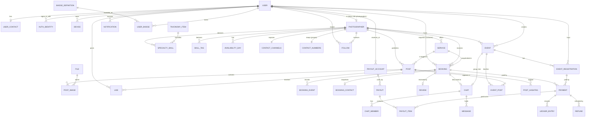

# Mô hình miền

Thực thể, đối tượng giá trị, quan hệ và danh mục enum của hệ thống, **độc lập với nơi lưu trữ**. Quy chuẩn kiểu ở [README.md](README.md) mục 2; bảng lưu trữ ở [relational-schema.md](relational-schema.md). Mã lớp bằng Dart (bất biến, freezed) ở `lib/domain/`; máy chủ dùng cùng tên khái niệm.

## 1. Đối tượng giá trị (value objects)

Bất biến, so sánh theo giá trị, tự kiểm tra hợp lệ khi tạo. Không có danh tính riêng.

| Đối tượng | Trường | Quy tắc |
|-----------|--------|---------|
| `Id<T>` | `value: String` | 1–64 ký tự `[A-Za-z0-9_-]`; không so sánh giữa kiểu `T` khác nhau |
| `Instant` | `utc: DateTime` | Luôn UTC; JSON ISO‑8601 `Z` |
| `LocalDate` | `y, m, d` | Ngày theo múi giờ Asia/Ho_Chi_Minh; JSON `yyyy-MM-dd` |
| `LocalTime` | `h, m` | `HH:mm`, bội số 5 phút trong giao diện, lưu phút |
| `Money` | `amount: int`, `currency: String = 'VND'` | `amount ≥ 0`; phép cộng cùng tiền tệ; `percent(30)` làm tròn xuống |
| `GeoPoint` | `lat: double`, `lng: double` | `-90..90`, `-180..180`; sinh `geohash(precision)` |
| `PhoneNumber` | `e164: String` | Chuẩn hoá `+84…`; kiểm `^(?:\+84\|0)(3\|5\|7\|8\|9)\d{8}$` cho số VN; quốc tế `^\+\d{8,15}$`; `masked()` trả `0903 ••• 456` |
| `FileRef` | `fileId: Id<File>` | Tham chiếu tới `File`; URL dựng lúc chạy |
| `Verdict` | `tomato` \| `brick` | thay `Rating` 1..5 (2026-10-06) |
| `ReviewSubjectType` | `photographer` \| `studio` | đối tượng của một đánh giá; #130 chỉ ghi `photographer`, `studio` do #136 |
| `ReviewReason` | `late` \| `not_as_portfolio` \| `slow_delivery` \| `attitude` \| `price_changed` \| `other` | lý do gạch |
| `TicketCode` | `value: String` | `VE-XXXX-MMDD`, duy nhất; chữ in hoa không có `0/O/1/I` |
| `Percent` | `value: int` | 0..100 |
| `DateRange`, `TimeRange` | `start, end` | `start < end` |
| `Reason` | `code: ReasonCode`, `text: String` | Lý do gợi ý |

## 2. Thực thể

Ký hiệu: **PK** khoá chính, **FK** khoá ngoại, `?` có thể rỗng, `🔒` dữ liệu nhạy cảm (tách bảng riêng).

### 2.1 Tài khoản và hồ sơ

| Thực thể | Trường chính | Ghi chú |
|----------|--------------|---------|
| `User` | `id` PK, `displayName`, `avatar: FileRef?`, `role: UserRole?`, `staffRole: StaffRole?`, `city?`, `locale = 'vi'`, `createdAt`, `updatedAt`, `deletedAt?` | `role = null` cho tới khi chọn ở màn chọn vai trò; `staffRole` chỉ do admin đặt |
| `UserContact` 🔒 | `userId` PK/FK, `phone: PhoneNumber`, `phoneVerified = false`, `allowZalo = true`, `allowWhatsApp = false`, `updatedAt` | Số điện thoại khách; không nằm trong `User` (công khai) |
| `AuthIdentity` 🔒 | `id` PK, `userId` FK, `provider: AuthProvider`, `subject`, `email?`, `createdAt` | `(provider, subject)` duy nhất; cho phép đổi IdP |
| `Device` 🔒 | `id` PK (Firestore: `{uid}_{installId}`, `installId` sinh một lần cho mỗi lần cài), `userId` FK, `provider: PushProvider`, `token`, `platform`, `lastSeenAt` | Thay `users.fcmTokens` |
| `File` | `id` PK, `ownerUserId` FK, `storageProvider`, `storageKey`, `mimeType`, `sizeBytes`, `width?`, `height?`, `blurhash?`, `createdAt` | Mọi ảnh/tệp |

### 2.2 Nhiếp ảnh gia

| Thực thể | Trường chính | Ghi chú |
|----------|--------------|---------|
| `Photographer` | `userId` PK/FK, `bio`, `yearsExperience`, `serviceArea: {city, center: GeoPoint, radiusKm}`, `cover: FileRef?`, `verified = false`, `verifiedAt?`, `onboardingComplete = false`, `acceptsInquiries = true`, `followerCount = 0`, `followerCountAt?`, `stats: PhotographerStats` | `stats` do dịch vụ tính; `followerCount` dẫn xuất từ `Follow` (server-only trigger recount, #143) |
| `PhotographerStats` | `tomatoCount`, `brickCount`, `tomatoPct: int`, `score: double (−1..1)`, `reviewCount`, `completedCount`, `responseMinutesMedian?`, `startingPrice: Money?`, `nextFreeDate?`, `skillsCompleteness`, `skillsCompletenessNext?` (mã bước còn thiếu đầu tiên), `skillsCompletenessNextAfter?` (điểm sau bước đó), `skillsEvidenceRemovedAt?` (lần Function gỡ minh chứng gần nhất) | Giá trị dẫn xuất, ghi bởi use case. Bất biến: `stats.reviewCount` luôn dùng thay cho `stats.rating`. `startingPrice` do `onServiceWrite` ghi; `completedCount` do `onBookingWrite` ghi; `nextFreeDate` tính từ `availability` (hướng sự kiện + rollover 00:10 hằng ngày). `catalog/explore` lưu tổng số gói hoạt động và ảnh bìa theo thể loại chuyên môn (#132). |
| `ContactChannels` | `photographerId` PK/FK, `call`, `zalo`, `whatsapp` | Công khai (cờ) |
| `ContactNumbers` 🔒 | `photographerId` PK/FK, `phone`, `zaloPhone?`, `whatsappPhone?` | Không lộ ra khỏi use case `get_contact_link` |
| `Service` (gói) | `id` PK, `photographerId` FK, `name`, `specialtyId?`, `durationMinutes`, `price: Money` (> 0), `photoCount`, `editedCount`, `deliveryDays`, `cover?`, `active` | |
| `SpecialtySkill` | `photographerId`, `specialtyId`, `level: SkillLevel (1..3)`, `years?`, `evidence: List<Id<Post>>` | Tối đa 6 thể loại, 3 mức 3 |
| `SkillTag` | `photographerId`, `group: SkillGroup`, `itemId` | style, extra, language, audience |
| `TaxonomyItem` | `id` PK (mã), `group`, `labelVi`, `parentId?`, `sortOrder`, `active` | Danh mục thể loại, phong cách, kỹ năng, ngôn ngữ, đối tượng, khu vực |
| `AvailabilityDay` | `photographerId`, `day: LocalDate`, `state: DayState`, `bookingId?`, `eventId?` | PK `(photographerId, day)`; không có bản ghi = rảnh |

### 2.3 Nội dung

| Thực thể | Trường chính | Ghi chú |
|----------|--------------|---------|
| `Post` | `id` PK, `authorId` FK, `kind: PostKind` (`work`, `real_shoot`, `event_share`), `photographerId` FK, `serviceId` FK, `bookingId?`, `caption`, `location: {name, point, geohash}`, `styleId?`, `specialty?` (= `specialtyId` của dịch vụ, phi chuẩn hoá), `hashtags` (chữ thường, không dấu `#`), `inPortfolio`, `likeCount`, `saveCount`, `createdAt`, `deletedAt?` | `serviceId` bắt buộc |
| `PostImage` | `postId`, `position`, `file: FileRef` | 1–10 ảnh; ánh xạ từ `imageMeta[]` (`blurHash`, `w`, `h`) → `post_images` |
| `PostHashtag` | `postId`, `tag` (chữ thường, không dấu `#`) | PK ghép; trích từ chú thích khi ghi bài |
| `Like`, `Save` | `userId`, `postId`, `createdAt` | PK ghép; đếm là dẫn xuất |
| `SavedPhotographer` | `userId`, `photographerId`, `createdAt` | PK ghép; marker Firestore `savedPhotographers/{userId}_{photographerId}` (#143) |
| `Follow` | `followerId`, `photographerId`, `createdAt` | PK ghép; marker Firestore `userId` ↔ `follower_id` |

### 2.4 Đặt lịch và thanh toán

| Thực thể | Trường chính | Ghi chú |
|----------|--------------|---------|
| `Booking` | `id` PK, `customerId`, `photographerId`, `serviceId`, `serviceSnapshot: {name, price: Money, durationMinutes}`, `day: LocalDate`, `start: LocalTime`, `end: LocalTime`, `place: {name, point?}`, `note?`, `status: BookingStatus`, `deposit: Money`, `remaining: Money`, `depositProvider?`, `depositPaidAt?`, `depositRefundedAt?`, `checkout?: BookingCheckout` (chỉ `draft`), `payableUntil?: Instant` (chỉ `draft`), `acceptDeadline?: Instant`, `cancel?: {by, reason, at, refundPercent}`, `chatId?`, `reviewedAt?` (server ghi khi `submitReview` thành công; `status` không đổi), `version`, `createdAt`, `updatedAt` | Snapshot gói tại thời điểm đặt. Từ #129 khách trả **100%**: `deposit` giữ **toàn bộ giá** (= `serviceSnapshot.price`) và `remaining` luôn 0; tên trường `deposit` còn lại cho tới khi làm hai mốc (`terms.price`, #130 và #134). `BookingCheckout` = `{paymentId, method: PaymentMethod, amount: Money, expiresAt: Instant, transferCode, attempt, qrPayload?, bankName?, accountMasked?, payUrl?, bankAppsUrl?}`: bản sao do `createPayment` ghi để app vẽ QR hoặc mở ví mà không đọc `payments`; số tài khoản thu hộ chỉ lưu dạng che. `payableUntil` = `createdAt + 30 phút`, đẩy lên `expiresAt + 5 phút` mỗi khi tạo khoản; job dọn xoá `draft` quá hạn này |
| `BookingEvent` | `id` PK, `bookingId`, `status`, `at: Instant`, `actorId?` | Dòng thời gian (thay `timeline[]`) |
| `BookingContact` 🔒 | `bookingId` PK/FK, `name`, `phone`, `allowZalo`, `allowWhatsApp`, `redactedAt?` | Chụp lúc yêu cầu (lưu tại `bookings/{id}/private/contact`); xoá số ngay khi huỷ/từ chối hoặc sau 30 ngày completed |
| `Payment` | `id` PK, `subjectType: PaymentSubject`, `subjectId`, `payeeId?` (nhiếp ảnh gia hoặc chủ sự kiện nhận tiền), `provider: PaymentProvider`, `method?: PaymentMethod`, `amount: Money`, `status: PaymentStatus`, `transferCode?` (`PB XXXXXX`), `expiresAt?: Instant`, `receivedAmount?: Money` (tổng đã tính vào `amount`; thiếu thì cộng dồn), `payer?: StoredBankAccount` (mã hoá, lưu ngân hàng, 4 số cuối và tên chủ tk người chuyển, #201), `refundedAmount?: Money` (tổng số tiền đã hoàn trên payment, #201), `escrowStatus: EscrowStatus`, `releasedAt?`, `releaseAfter?`, `dispute?: {reason, openedAt}` (do `open_dispute` ghi; chỉ máy chủ đọc), `payoutId?` (bản sao Firestore của lô đang mở; quan hệ: join `payout_items`, xoá khi lô `failed`), `providerRef?`, `raw?: json`, `idempotencyKey`, `eventId?` (vé: sự kiện của đăng ký, để đóng dấu `releaseAfter` và tìm khoản hoàn khi huỷ sự kiện), `createdAt`, `updatedAt` | Dùng cho thanh toán 100% của booking và vé; `escrowStatus` theo dõi tiền treo (khoản `expired` ghi `refunded`: không có gì để giữ). `method`, `transferCode`, `expiresAt`, `receivedAmount`, `payer`, `refundedAmount` chỉ có ở khoản thanh toán booking (vé chưa chuyển sang, #137). Mã chuyển khoản: `"PB "` + 6 ký tự từ bảng `23456789ABCDEFGHJKMNPQRSTVWXYZ` (bỏ 0/O/1/I/L/U) suy ra từ id khoản bằng băm FNV-1a 32 bit, **duy nhất trên mọi khoản** (không riêng khoản đang mở); khi trùng thì sinh lại id, tối đa 3 lần |
| `LedgerEntry` | `id` PK, `type: LedgerEntryType`, `paymentId?`, `refundId?`, `payoutId?`, `subjectType?`, `subjectId?`, `accountOwnerId?`, `amount: Money` (có dấu), `note?`, `at: Instant` | **Bất biến, chỉ thêm**; số dư treo/chờ chi trả suy ra từ tổng |
| `PayoutAccount` 🔒 | `id` PK, `userId` FK, `bankCode`, `accountNumberEnc`, `accountLast4`, `holderName` (tên ngân hàng trả về, hoặc tên đã xác minh khi ngân hàng không tra được), `nameStatus: NameStatus`, `activeFrom: Instant`, `active`, `createdAt`, `deactivatedAt?` | Tài khoản nhận tiền; số được mã hoá; đổi tài khoản giữ bản cũ với `active = false`. Tài khoản đầu có `activeFrom = createdAt`; tài khoản đổi có `activeFrom = createdAt + 72 giờ` và chưa nhận tiền trước đó (`isAccountActiveAt`). Bản ghi cũ đọc `nameStatus = matched`, `activeFrom = createdAt` |
| `Payout` | `id` PK, `payeeId` FK, `amount: Money` (**tổng gộp** của các khoản), `platformFee: Money` (hoa hồng), `taxWithheld: Money` (thuế khấu trừ), `amountNet: Money` (= `amount` − `platformFee` − `taxWithheld`; số thật sự chuyển), `feeRateBp: int`, `taxRateBp: int` (tỉ lệ đã dùng, ghi lại để lịch sử không đổi khi chính sách đổi; 700 = 7%), `firstPayout: bool` (chưa có lô nào của tài khoản này được duyệt hay đã chi), `status: PayoutStatus`, `accountId` FK, `reference?`, `idempotencyKey` (= id lô), `provider` (`fake` cho tới khi có tổ chức trung gian), `createdAt`, `scheduledAt?`, `paidAt?`, `failureReason?`, `holdReason?` (`repeated_failure` khi 3 lô cuối của tài khoản đều `failed`), `createdBy` FK (nhân viên hoặc `system:createPayouts`), `items: PayoutItem[]` (Firestore nhúng; quan hệ: bảng `payout_items`), `approvedBy?`, `approvedAt?` | Lô chi trả cho một người nhận. `status = needs_approval` khi là lô đầu tới tài khoản (chưa có lô nào của tài khoản đó đã `paid` hay đã được duyệt và đang `pending`/`processing`; lô `failed` không tính) hoặc tài khoản `pending_review`; ngoại lệ `on_hold` khi 3 lô đã xong gần nhất của tài khoản đều `failed`; staff duyệt một lần cho mỗi tài khoản (`approvePayout`). Bản ghi cũ đọc phí 0, thuế 0, `amountNet = amount`, `firstPayout = false` |
| `EarningItem` / `EarningsSummary` (đọc, S06.05) | `EarningItem`: `id` = `paymentId`, `payeeId`, `subjectType`, `subjectId`, `counterpartName`, `subjectLabel`, `day`, `amount: Money` (gộp, đã trừ hoàn tiền), `platformFee`, `taxWithheld`, `netAmount: Money`, `feeRateBp`, `taxRateBp`, `estimated: bool` (true tới khi khoản được chuyển: số lấy từ chính sách; false: số của `PayoutItem`), `milestonesDone?`, `milestonesTotal?` (đọc từ `bookings/{id}/milestones`; chưa có thì bỏ trống), `state: EarningState`, `holdReason?` (mã cố định, không phải chữ của khách), `paidOutAt?`, `updatedAt`. `EarningsSummary`: `payeeId`, `heldAmount`, `soonAmount`, `receivedAmount`, `lastPayout?`, `updatedAt` | **Hình chiếu** tính bởi `earningsOf`/`refresh_earnings` từ `Payment`, `Refund`, `Payout`; không phải bảng (máy chủ riêng tính bằng SQL) |
| `PayoutItem` | `payoutId`, `paymentId`, `amount: Money` (gộp), `fee: Money`, `tax: Money`, `net: Money` | Khoản nào nằm trong lô nào; PK ghép. Phí và thuế tính **trên từng khoản** bằng `Math.round(amount × bp / 10000)` (`payoutLineOf`, chính sách `DEFAULT_PAYOUT_POLICY`: hoa hồng 0 cho mọi loại, thuế 5% GTGT + 2% TNCN = 7% cho `individual` và `artist`, 0 cho `studio`); `net = amount − fee − tax`, tổng của lô là tổng các khoản nên từng dòng ở S06.05 cộng ra đúng |
| `OtpChallenge` 🔒 | `uid` FK, `purpose: 'payout_account'`, `codeHash`, `salt`, `targetHash` (băm có muối của `salt:bankCode:số` của tài khoản mới sắp lưu), `expiresAt`, `attempts`, `sentAt`, `sendDay` (yyyy-MM-dd giờ Việt Nam), `sendsToday`, `consumedAt?` | Mã xác nhận khi đổi tài khoản nhận tiền: 6 số, hiệu lực 5 phút, sai 5 lần phải gửi lại, gửi lại sau 60 giây, tối đa 5 lần mỗi ngày; chỉ lưu băm có muối của mã (không lưu mã, không lưu số tài khoản), dùng một lần, gắn với một tài khoản. Chỉ máy chủ đọc/ghi (Firestore `otp_challenges/{uid}_payout_account`; quan hệ: bảng `otp_challenges`, khoá `(user_id, purpose)`); **không** đặt dưới `users/{uid}/private/` vì quy tắc ở đó cho chủ đọc mọi tài liệu. Cùng chỗ: hạn mức tra tên `payout_lookups/{uid}` `{day, count}` (20 lần mỗi ngày, cũng chỉ máy chủ) |
| `Refund` | `id` PK, `paymentId` FK, `subjectType: PaymentSubject`, `amount: Money`, `percent`, `status: RefundStatus`, `method: RefundMethod`, `destination?: RefundDestination` (tài khoản nhận hoàn, mã hoá, `source: 'payer' | 'customer'`), `confirmBy?: Instant` (hạn xác nhận tài khoản hoàn, #141), `attempts: int` (số lần đã gọi cổng/chi hộ), `lastAttemptAt?: Instant`, `failureReason?`, `manual`, `fromEscrow` (true: tiền lấy ra từ ký quỹ — huỷ, từ chối, tranh chấp, khoản trả khi bản nháp đã mất; false: tiền trả lại ngay khi nhận, chưa từng vào ký quỹ — `overpaid_excess`, `extra_transfer`, `late_transfer`, `underpaid_expired`; giải ngân, chi trả và thu nhập chỉ trừ hoàn có `fromEscrow`; bản ghi cũ thiếu trường coi là true; không bao giờ suy ra từ `reason`), `reason?` (`overpaid_excess`, `underpaid_expired`, `late_transfer`, `extra_transfer`, cùng các lý do huỷ/từ chối cũ), `providerRef?`, `createdAt`, `updatedAt` | `id` là khoá chống trùng gửi sang cổng (gửi lại cùng id không hoàn hai lần). #201 bổ sung `method`, `destination`, `confirmBy`, `attempts`, `lastAttemptAt`, `failureReason`. |
| `PaymentNotification` 🔒 | `id` PK = `{provider}_{txnId}`, `provider`, `txnId` (mã giao dịch của tổ chức trung gian), `raw` (nội dung gốc, chuỗi), `receivedAt: Instant` (UTC), `outcome: TransferOutcome` (trừ `duplicate`), `paymentId?` | Khoá chống trùng của webhook: ghi cùng giao dịch với khoản, bút toán và lệnh hoàn, nên webhook gửi lại hoặc job đối soát gặp lại là không làm gì. Lưu `payer` chỉ trong `raw`. Client không đọc được; chỉ máy chủ ghi |
| `Review` | `id` PK = `reviewDocId(bookingId, subjectType)` (`bookingId` với `photographer`, `{bookingId}_studio` với `studio`), `bookingId` FK, `subjectType: ReviewSubjectType` (`photographer` \| `studio`), `subjectId` (tài khoản mà đánh giá cộng vào `stats`), `photographerId` (= `subjectId`, để truy vấn tab Đánh giá), `customerId`, `serviceId`, `serviceName` (ảnh chụp của gói), `bookingDay` (`yyyy-MM-dd`, ảnh chụp của booking), `verdict: Verdict`, `hits: int (1..10)`, `intensity: double` (server tính từ `hits`: `round2(0,4 + 0,6·log10(hits))`), `reasons: ReviewReason[]`, `text`, `photoPostId?`, `createdAt`, `countedAt?` (server) | Một đánh giá cho mỗi đối tượng trong một booking; không có `rating`. Doc sao cũ không có `verdict` đọc như `tomato` khi `rating ≥ 4`, ngược lại `brick` (chỉ hiển thị) |

### 2.5 Trò chuyện và thông báo

| Thực thể | Trường chính | Ghi chú |
|----------|--------------|---------|
| `Chat` | `id` PK, `kind: ChatKind` (`inquiry`, `booking`, `event_group`), `bookingId?` (duy nhất khi có), `eventId?` (duy nhất khi `event_group`), `customerId?`, `photographerId?` (rỗng với nhóm), `assigneeId?` (nhân viên hỗ trợ, chat hỏi trước của sự kiện nền tảng), `moderatorsOnly = false`, `photographerRepliedAt?`, `lastMessageAt?`, `lastMessagePreview?`, `bookingStatus?: BookingStatus` (read model: bản sao `Booking.status` của `bookingId`, máy chủ ghi mỗi lần booking đổi trạng thái kể cả `upcoming` và `reviewed`; null với `inquiry`; nguồn sự thật vẫn là `Booking.status`) | `inquiry` → thành `booking` khi gắn `bookingId`; chat `booking` hết hạn chỉ đọc → thành `inquiry` lại khi khách mở "Nhắn tin hỏi trước" (`bookingId`, `bookingStatus`, `readOnlyAt` xoá); `photographerRepliedAt != null` gỡ giới hạn 3 tin; "đã đóng" của `inquiry` được tính (`lastMessageAt ?? createdAt` + 14 ngày), không lưu |
| `ChatMember` | `chatId`, `userId`, `role: ChatMemberRole`, `mutedUntil?`, `unreadCount`, `lastReadAt?`, `joinedAt`, `removedAt?` | Thành viên nhóm sự kiện có vai `member`/`moderator` |
| `ChatPin` | `chatId`, `messageId`, `pinnedBy`, `pinnedAt` | Tin ghim (thông báo của chủ sự kiện) |
| `Message` | `id` PK, `chatId`, `senderId?`, `type: MessageType`, `body?`, `file?`, `point?`, `createdAt`, `deletedAt?` | `system` không có người gửi |
| `Notification` | `id` PK (xác định: `n_{dedupeKey}` hoặc `g_{groupKey}`), `userId`, `type: NotificationType`, `tab: NotificationTab`, `category: NotificationCategory`, `title`, `body` (server dựng, tiếng Việt), `target` (đường dẫn app), `groupKey?`, `actors?: [{id, name, avatarUrl?}]` (≤ 3), `count`, `thumbUrl?`, `lastEventId?`, `recentEventIds: [string]` (dòng gộp: 20 mã sự kiện gần nhất, mới nhất trước; trùng trong danh sách = bản trùng), `readAt?`, `createdAt` | Hộp thư S17.01. Số chưa đọc **không** nằm trên `User` công khai: `users/{uid}/private/inbox` = `{unreadCount, unreadCountAt}`, chỉ chủ đọc, chỉ server ghi (quyết định 2026-10-06) |
| `NotificationPrefs` 🔒 | `userId` PK, `channels: {booking, jobs, instant, events, chat, badges, promo}: {push, inApp}`, `quietHours: {enabled, from, to}` ("HH:mm", giờ VN), `reminders: {h24, h2}` | Mặc định: mọi nhóm bật, `promo` tắt, yên lặng 22:00–07:00, nhắc 24 giờ và 2 giờ; `booking.inApp` luôn true. Firestore: `users/{uid}/private/notification_prefs` |

### 2.6 Sự kiện

| Thực thể | Trường chính | Ghi chú |
|----------|--------------|---------|
| `Event` | `id` PK, `hashtag` (duy nhất, chữ không dấu + số), `chatId?`, `host: {type: HostType, photographerId?}`, `createdBy`, `createdByRole`, `title`, `description`, `cover: FileRef`, `type: EventType`, `startsAt: Instant`, `endsAt: Instant`, `location: {name, meetingPoint?, point, geohash}`, `capacity`, `price: Money` (≥ 0; 0 = không thu phí), `registrationDeadline`, `status: EventStatus`, `registeredCount`, `heldCount`, `hostConsent: HostConsent`, `hostConsentExpiresAt?: Instant` (O1: lúc mời + 24 giờ), `soonNoticeAt?: Instant` (dấu của job nhắc `event_soon`: đặt khi mọi vé đã paid được nhắc 48 giờ trước giờ bắt đầu; chỉ máy chủ ghi, rỗng = chưa nhắc; không đặt lại khi dời giờ), `soonNotifiedRegIds: [RegistrationId]` (chỉ máy chủ ghi: các vé đã được nhắc khi lượt nhắc còn dở, để lượt thử lại không gửi lại; xoá khi đặt `soonNoticeAt`), `faq: [{question, answer}]` (O2: chỉ sự kiện `platform`, staff nhập; ≤ 10, 120/500 ký tự), `version`, `createdAt`, `updatedAt` | `isFree` = `price.amount == 0` |
| `EventPost` | `eventId`, `postId`, `source: EventPostSource`, `status: EventPostStatus`, `addedAt`, `moderatedBy?` | PK ghép; bài hiện trên timeline sự kiện |
| `EventRegistration` | `id` PK, `eventId`, `userId`, `name`, `phone` 🔒, `quantity (1..4)`, `amount: Money`, `status: RegistrationStatus`, `holdExpiresAt?`, `ticketCode: TicketCode`, `paymentId?`, `checkedInAt?`, `cancelledAt?`, `refundPercent?`, `contactEligible: bool` (O3: true chỉ với vé trả tiền đã `paid`; vé không thu phí không mở liên hệ), `refundDue: bool` (sự kiện huỷ khi tiền vé còn treo; clock hoàn 100%), `refundId?`, `refundStatus?: pending\|done\|failed` (bản sao trạng thái khoản hoàn trên vé), `version` | `ticketCode` duy nhất. O4: huỷ vé trả tiền dưới 48 giờ không hoàn, tiền vẫn treo và chuyển cho chủ sau sự kiện |

### 2.7 Huy hiệu, gợi ý, vận hành

| Thực thể | Trường chính | Ghi chú |
|----------|--------------|---------|
| `BadgeDefinition` | `id` PK, `nameVi`, `descriptionVi`, `iconKey`, `source: BadgeSource`, `audience`, `rule: json`, `sortOrder`, `active` | Danh mục do admin |
| `UserBadge` | `userId`, `badgeId`, `awardedAt`, `snapshot?: json` | PK ghép |
| `BadgeProgress` 🔒 | `userId`, `badgeId`, `current`, `target`, `updatedAt` | |
| `RecommendationLog` | `id` PK, `requestId`, `userKey` (băm), `signalType`, `photographerId`, `rank`, `algorithm`, `algorithmVersion`, `at` | Tín hiệu, không lưu uid thật |
| `ContactAccessLog` | `id` PK, `requesterId`, `subjectType`, `subjectId`, `channel`, `granted`, `at` | Nhật ký `get_contact_link` |
| `AuditLog` | `id` PK, `actorId?`, `action`, `entityType`, `entityId`, `diff?: json`, `at` | Không xoá |
| `AppConfig` | `key` PK, `value: json`, `version`, `updatedAt` | Trọng số gợi ý, cờ tính năng |

### 2.8 Loại nhà cung cấp, album, giải thưởng, hợp đồng và Đăng việc (2026-10-05)

Nguồn: [`../2026-10-05-provider-types-portfolio-jobs-design.md`](../2026-10-05-provider-types-portfolio-jobs-design.md) ("spec 10-05"). Phần hợp đồng (`Booking` đổi, `Milestone`, `Delivery`) là **đề xuất**, áp dụng khi câu hỏi mở 26 của spec chính được chốt; tới lúc đó `Booking` ở mục 2.4 vẫn là bản đang chạy.

| Thực thể | Trường chính | Ghi chú |
|----------|--------------|---------|
| `Photographer` (thêm trường) | `providerType: ProviderType = individual`, `artistSince?: Instant`, `studioDistrict?: string`, `studioCity?: string` (công khai, sao từ `StudioAddress`, chỉ server ghi), `approvedAwardCount` (dẫn xuất), `acceptingOrders: bool` (dẫn xuất = `verified` và `onboardingComplete`, công khai, chỉ server ghi; quy tắc `acceptsOrders` trong `packages/domain`) | `artist` chỉ server ghi (mục 2.3 spec 10-05); `acceptingOrders` do trigger `onPhotographerWrite` giữ đồng bộ, cổng server đọc `verified` + `onboardingComplete` chứ không đọc cờ này (#133) |
| `StudioAddress` 🔒 | `photographerId` PK/FK, `line`, `ward?`, `district`, `city`, `point?` | Chỉ khi `studio`; công khai tới mức quận, đầy đủ sau khi đã đặt |
| `Award` | `id` PK, `photographerId` FK, `competition`, `year`, `category?`, `result: AwardResult`, `workPostId?` FK, `status: AwardStatus`, `reviewNote?`, `reviewedBy?`, `reviewedAt?`, `createdAt`, `updatedAt` | Chỉ `approved` công khai |
| `AwardProof` 🔒 | `awardId` PK/FK, `files: List<FileRef>` (≤ 3), `links: List<Url>` (≤ 2, https), `purgeAfter?` | Chủ hồ sơ và staff đọc; xoá 30 ngày sau trạng thái cuối |
| `Album` | `id` PK, `photographerId` FK, `title` (1–40), `description?` (≤ 300), `cover?: {postId, position}`, `position`, `postCount`, `mediaCount` (dẫn xuất), `createdAt`, `updatedAt` | Tối đa 30/người; trống thì không công khai |
| `Post` (thêm trường) | `albumId?` FK, `albumPosition?` | Tối đa một album; `inPortfolio` thành dẫn xuất |
| `PostMedia` (thay `PostImage` khi bật video) | `postId`, `position`, `kind: MediaKind`, `file: FileRef`, `durationMs?`, `poster?: FileRef` | Bản đầu chỉ `image` |
| `Service` (thêm trường) | `revisions = 1` (0–5) | |
| `BookingTerms` (đối tượng giá trị) | `price: Money`, `durationMinutes`, `photoCount`, `editedCount`, `deliveryDays`, `revisions`, `milestones: List<{kind: MilestoneKind, percent}>` | Bản chụp khi tạo booking |
| `Booking` (đổi, đề xuất) | thêm `source: BookingSource`, `terms: BookingTerms`, `jobId?`, `quoteId?`, `revisionsUsed`, `shotAt?`, `deliveredAt?`, `approvedAt?`, `autoApproveAt?`; `serviceId` chỉ bắt buộc khi `source = package`; bỏ `deposit`/`remaining` | `serviceSnapshot` giữ để đọc ngược |
| `Milestone` | `bookingId` FK, `kind: MilestoneKind`, `amount: Money`, `status: MilestoneStatus`, `releaseAfter?`, `releasedAt?` | PK `(bookingId, kind)`; bút toán `escrow_released` trên cùng `Payment` |
| `Delivery` | `id` PK, `bookingId` FK, `round`, `link` (https), `previews: List<FileRef>` (≤ 10), `note?`, `submittedAt`, `decision?: {kind: DeliveryDecision, note?, at}` | `round` = 1 + số lần sửa |
| `JobPost` | `id` PK, `customerId` FK, `specialtyId`, `title` (10–60), `description` (≤ 1000), `references: List<FileRef>` (≤ 5), `schedule: {kind: ScheduleKind, day?, start?, end?, from?, to?, durationMinutes}`, `area: {city, district, geohash}`, `budget?: {min: Money, max: Money}`, `wants: {editedCount?, deliveryDays?}`, `allowedProviders: AllowedProviders`, `quoteDeadline: Instant`, `extended = false`, `status: JobStatus`, `quoteCount`, `viewCount`, `awardedQuoteId?`, `bookingId?`, `createdAt`, `updatedAt` | Không chứa địa chỉ cụ thể hay số điện thoại |
| `Quote` | `id` PK, `jobId` FK, `photographerId` FK, `basedOnServiceId?`, `terms: BookingTerms`, `message` (20–500), `albumId?`, `status: QuoteStatus`, `createdAt`, `updatedAt` | Duy nhất `(jobId, photographerId)` |
| `JobInvite` | `jobId`, `photographerId`, `createdAt`, `seenAt?` | PK ghép; tối đa 5 mỗi việc |

## 3. Quan hệ (ERD)



Quan hệ nhiều‑nhiều: `Photographer ↔ TaxonomyItem` qua `SpecialtySkill`/`SkillTag`; `User ↔ Post` qua `Like`/`Save`; `User ↔ Photographer` qua `Follow`; `Chat ↔ User` qua `ChatMember`.

## 4. Danh mục enum

Mã chuỗi ổn định, nhãn nằm ở i18n. Không đổi nghĩa hay xoá mã đang dùng.

| Enum | Mã | Ghi chú |
|------|----|---------|
| `UserRole` | `customer`, `photographer` | Người dùng tự chọn |
| `StaffRole` | `admin`, `sales` | Claim, không chọn tự do |
| `AuthProvider` | `password`, `google`, `facebook`, `apple`, `oidc` | |
| `PushProvider` | `fcm`, `apns` | |
| `SkillLevel` | `1` cơ bản, `2` thành thạo, `3` chuyên sâu | Số 1..3 là ngoại lệ cố ý (có thứ tự thật) |
| `SkillGroup` | `specialty`, `style`, `extra`, `language`, `audience`, `area` | |
| `Specialty` (mã trong `taxonomy`) | `portrait`, `wedding`, `couple`, `family`, `graduation`, `event`, `product`, `travel`, `fashion`, `food`, `real_estate`, `newborn`, `street`, `commercial` | Danh mục mở, thêm không cần phát hành |
| `DayState` | `off`, `booked`, `pending` | Rảnh = không có bản ghi |
| `PostKind` | `work`, `real_shoot`, `event_share` | `event_share`: người tham gia đăng về sự kiện; `photographerId` để rỗng nên bài không vào portfolio của ai |
| `BookingStatus` | `draft`, `requested`, `accepted`, `declined`, `expired`, `cancelled`, `upcoming`, `completed`, `reviewed` | Máy trạng thái ở mục 5 |
| `PaymentSubject` | `booking`, `event_registration` | |
| `PaymentProvider` | `momo`, `vnpay` | |
| `PaymentStatus` | `created`, `paid`, `expired`, `needs_review`, `refunded`, `partially_refunded` | Trạng thái giao dịch với cổng. `expired`: không ai trả đủ trong hạn, hoặc QR bị thay bằng "Tạo QR mới". `needs_review`: để dành cho nhân viên (S23.02), chưa có đường code nào ghi lên `Payment` (chuyển không khớp được khoản nào chỉ ghi ở `PaymentNotification`). `failed` đã bỏ (chưa từng được ghi) |
| `PaymentMethod` | `bank_qr` (mặc định), `momo`, `zalopay`; để sẵn `domestic_card`, `intl_card` (tắt bằng cờ cấu hình, không nhận) | Cách khách trả; tách khỏi `PaymentProvider` (tổ chức trung gian) |
| `TransferOutcome` | `paid`, `paid_with_refund`, `partial`, `refunded`, `needs_review`, `duplicate` | Kết quả xử lý một thông báo chuyển khoản (`duplicate` không lưu) |
| `EscrowStatus` | `held`, `released`, `paid_out`, `partially_refunded`, `refunded`, `disputed` | Trạng thái tiền treo; xem mục 5 |
| `EarningState` | `held`, `disputed`, `released`, `paid_out` | Trạng thái tiền của một dòng Thu nhập: `held`/`partially_refunded` → `held`; còn lại cùng tên; `refunded` không có dòng |
| `LedgerEntryType` | `payment_received` (thay `deposit_received`; bản ghi cũ vẫn được đọc), `ticket_received`, `refund_issued`, `escrow_released`, `payout_paid`, `tax_withheld`, `platform_fee`, `fee_charged`, `adjustment` | Khi lô `paid`, mỗi khoản ghi `payout_paid` −`net`, và `tax_withheld` −`tax`, `platform_fee` −`fee` chỉ khi > 0 (không có bút toán −0). `gateway_fee`, `payout_fee`, `revenue_received` của spec thanh toán §8 chưa có chủ |
| `PayoutStatus` | `pending`, `needs_approval`, `on_hold`, `processing`, `paid`, `failed` | `needs_approval`: chờ staff duyệt (lần chi đầu tới một tài khoản); `approvePayout` chuyển về `pending` |
| `NameStatus` | `matched`, `pending_review`, `staff_confirmed` | Kết quả so tên chủ tài khoản với tên đã xác minh: `pending_review` khi ngân hàng không tra được tên (staff đối chiếu), `staff_confirmed` khi staff duyệt lô đầu |
| `RefundStatus` | `awaiting_account`, `pending`, `done`, `failed` | `awaiting_account`: chờ khách chọn tài khoản (S22.04 #141) khi thanh toán bằng QR mà thiếu thông tin người chuyển |
| `RefundMethod` | `gateway`, `bank_transfer` | `bank_transfer` cho khoản gốc `bank_qr`; `gateway` cho ví MoMo, ZaloPay và thẻ |
| `ChatKind` | `inquiry`, `booking`, `event_group` | |
| `ChatMemberRole` | `member`, `moderator` | |
| `EventPostSource` | `hashtag`, `explicit` | |
| `EventPostStatus` | `visible`, `pending`, `hidden` | |
| `MessageType` | `text`, `image`, `location`, `system` | |
| `NotificationType` | `booking_request`, `booking_accepted`, `booking_declined`, `booking_cancelled`, `refund_done`, `shoot_reminder`, `payout_released`, `quote_new`, `quote_withdrawn`, `job_expiring`, `job_expired`, `job_match`, `job_invited`, `quote_accepted`, `quote_not_selected`, `job_selected` (bỏ, thay bằng `quote_accepted`), `instant_assigned`, `instant_missed`, `instant_round_ended`, `instant_no_match`, `instant_arrived`, `instant_finished`, `instant_cancelled`, `event_soon`, `event_host_invited`, `review_new`, `review_tomato`, `review_brick`, `badge_new`, `award_reviewed`, `artist_granted`, `artist_revoked`, các loại bàn giao (`delivery_*`), studio (`studio_*`, `booking_assigned`, `booking_reassigned`, `assign_reminder`, `assign_overdue`, `change_requested`, `change_answered`, `assignment_returned`), chi trả (`payout_account_needed`, `payout_account_changed`), xác minh (`verification_*`, `business_*`), khiếu nại và hỗ trợ (`dispute_*`, `support_reply`, `refund_account_needed`), tuyển thợ (`recruit_*`, `collab_*`), `chat_message`, `promo` | Danh sách của `packages/domain/src/notification.ts` (`NOTIFICATION_TYPES`, nguồn duy nhất cho nhóm S17.02, mục lọc và "quan trọng"); thay danh sách cũ (`booking_requested`, `booking_reminder`, `badge_awarded`, `message`, `system`…) |
| `NotificationTab` | `activity`, `events`, `system` | Mục lọc S17.01, lưu trên mỗi dòng |
| `NotificationCategory` | `booking`, `jobs`, `instant`, `events`, `chat`, `badges`, `promo` | Hàng của S17.02 |
| `EventType` | `photo_walk`, `mini_session`, `workshop`, `cosplay`, `other` | |
| `EventStatus` | `draft`, `open`, `full`, `closed`, `cancelled`, `completed` | |
| `HostType` | `photographer`, `platform` | |
| `HostConsent` | `not_required`, `pending`, `accepted`, `declined`, `expired` | Tạo hộ nhiếp ảnh gia (O1: 24 giờ để đồng ý) |
| `RegistrationStatus` | `held`, `paid`, `cancelled`, `refunded` | |
| `BadgeSource` | `review`, `system` | |
| `BadgeAudience` | `photographer`, `customer`, `both` | |
| `BadgeMetric` | `tomatoPct`, `reviewCount`, `punctualMentions`, `detailedReviews`, `accountAgeDays`, `workPosts`, `activeServices`, `responseMinutes`, `completedShoots`, `hostedEvents`, `customerShoots`, `realShootPosts` | chỉ số mà `BadgeDefinition.rule` so sánh; `tomatoPct` thay `rating` (2026-10-07, #130): `top_rated` là `tomatoPct ≥ 95` với `minSample` `reviewCount ≥ 20` |
| `ReasonCode` | `skill_match`, `near`, `free_on_date`, `top_rated`, `fast_reply`, `new_talent` | |
| `SignalType` | `impression`, `click`, `inquiry`, `booking` | |
| `ContactChannel` | `in_app`, `call`, `zalo`, `whatsapp` | |
| `ErrorCode` | `day_taken`, `phone_required`, `contact_locked`, `sold_out`, `deadline_passed`, `limit_exceeded`, `invalid_argument`, `permission_denied`, `not_found`, `conflict`, `no_match`, `offer_expired`, `already_assigned`, `not_eligible`, `outside_service_area`, `price_changed`, `reauth_required`, `not_accepting_orders`, `blocked` | Mã lỗi nghiệp vụ ổn định; `reauth_required`: đổi tài khoản nhận tiền cần đăng nhập lại trong 5 phút; `not_accepting_orders`: thợ chưa nhận đơn (chưa `verified` hoặc chưa xong hồ sơ), máy chủ riêng trả 403 (spec xác minh §7); `blocked`: khách và thợ đã chặn nhau (một trong hai chiều); không đơn mới giữa hai người, máy chủ riêng trả 403. Tầng HTTP của máy chủ riêng thêm hai mã giao vận `unauthenticated` (401) và `internal` (500); use case không dùng hai mã này; sáu mã cuối của Chụp ngay (`../2026-10-01-instant-booking-design.md` mục 6) |

| `ProviderType` | `individual`, `artist`, `studio` | `artist` = hạng NAG, chỉ server ghi (spec 10-05) |
| `AwardResult` | `gold`, `silver`, `bronze`, `honorable`, `finalist`, `exhibited` | |
| `AwardStatus` | `pending`, `needs_info`, `approved`, `rejected`, `revoked` | |
| `MediaKind` | `image`, `video` | Bản đầu chỉ `image` |
| `BookingSource` | `package`, `quote`, `instant` | Đề xuất (spec 10-05 mục 4) |
| `MilestoneKind` | `shoot`, `delivery` | |
| `MilestoneStatus` | `held`, `released`, `refunded`, `disputed` | |
| `DeliveryDecision` | `approve`, `request_revision` | |
| `ScheduleKind` | `fixed`, `flexible` | |
| `JobStatus` | `draft`, `open`, `awarded`, `expired`, `closed` | |
| `QuoteStatus` | `submitted`, `withdrawn`, `accepted`, `not_selected`, `declined` | |
| `AllowedProviders` | `all`, `artist`, `studio` | |

## 5. Máy trạng thái

### Booking

```
draft ──(payment paid)──▶ requested ──(photographer accepts)──▶ accepted ──(T‑24h)──▶ upcoming ──(end, completed)──▶ completed ──(review)──▶ reviewed
                            │ decline ▶ declined (refund 100%)
                            │ past accept_deadline ▶ expired (refund 100%)
   requested/accepted/upcoming ──(customer cancels)──▶ cancelled (refund by policy)
   accepted/upcoming ──(photographer cancels)──▶ cancelled (refund 100%)
```

Bảng chuyển hợp lệ do use case `transition_booking` thực thi và test. Mỗi chuyển ghi `BookingEvent`, cập nhật `AvailabilityDay`, gửi `Notification`.

### Event và Registration

```
Event:        draft ─▶ open ─▶ full ─▶ closed ─▶ completed        (mọi trạng thái trừ completed ─▶ cancelled)
Registration: held ─(paid)─▶ paid ─(cancel ≥48h)─▶ refunded       held ─(hết 10 phút)─▶ cancelled
```

### Chat hỏi trước

`inquiry` (khách tối đa 3 tin khi `photographerRepliedAt` rỗng) → nhiếp ảnh gia (hoặc nhân viên hỗ trợ với sự kiện nền tảng) trả lời → `photographerRepliedAt` đặt, **hai bên nhắn tự do** → 14 ngày không có tin từ cả hai phía thì chat hỏi trước được coi là đã đóng (tính từ `lastMessageAt ?? createdAt`, không lưu trường nào; mở lại khi có tin mới) → khi khách đặt lịch: gắn `bookingId`, `kind = booking`.

### Tiền treo (escrow)

```
held ──(completed + hết cửa sổ khiếu nại)──▶ released ──(lô chi trả paid)──▶ paid_out
 ├──▶ partially_refunded / refunded      (hoàn từ số treo, theo chính sách)
 └──▶ disputed ──(admin)──▶ released | refunded | partially_refunded
```

Mỗi chuyển ghi `LedgerEntry` bất biến. `released` còn gọi là "sắp nhận" ở S06.05.

### Thanh toán (Payment của booking, #129)

```
created ──(Σ nhận ≥ amount, còn hạn)──▶ paid          (phần thừa hoàn ngay: paid_with_refund)
   │──(hết hạn / Tạo QR mới)──────────▶ expired       (đã nhận gì thì hoàn: underpaid_expired)
   └──(chuyển sau hạn)────────────────▶ giữ nguyên, hoàn toàn bộ (late_transfer)
paid / refunded ◀── chuyển thêm vào khoản này: hoàn toàn bộ (extra_transfer)
Không khớp mã nào: PaymentNotification.outcome = needs_review (chưa đụng tới Payment).
```

Chuyển thiếu rồi bù thêm trước hạn cộng dồn vào `receivedAmount`; "hết hạn" tính theo `receivedAt` của giao dịch, không chờ job đổi trạng thái. Khớp nội dung: chuyển chữ hoa, bỏ mọi ký tự ngoài `A-Z0-9`, lấy mã `PB` + 6 ký tự hợp lệ đầu tiên chỉ tới một khoản (bỏ khoản tạo sau `receivedAt`), nên "pb7f3k2q chuyen tien" hay "CK PB-7F3K2Q" đều khớp. Lệnh hoàn lỗi khi gọi cổng: `Refund` `failed` + `manual`, các bước còn lại vẫn chạy.

### Nhóm chat sự kiện

`event_group` tạo cùng sự kiện (hoặc khi có thành viên đầu); thành viên vào khi `EventRegistration` `paid`, ra khi `refunded`/`cancelled`; đóng ghi 7 ngày sau `completed`, chỉ đọc 30 ngày rồi lưu trữ.

### Mở khoá liên hệ

`contact_unlocked(subject)` = booking ở `requested | accepted | upcoming | completed(≤30 ngày)` **hoặc** vé `paid` (≤7 ngày sau sự kiện). Use case `get_contact_link` kiểm điều kiện này, ghi `ContactAccessLog`, rồi trả URL.

### Giải thưởng, hạng NAG (spec 10-05 mục 2)

```
Award: pending ─▶ approved | needs_info | rejected      needs_info ─(sửa)─▶ pending
       approved ─(chủ sửa)─▶ pending                    approved ─(staff thu hồi)─▶ revoked
Photographer.providerType: individual ─(≥ 3 Award approved)─▶ artist ─(< 3)─▶ individual     (studio không đổi)
```

### Booking theo hợp đồng (đề xuất, spec 10-05 mục 4.3)

```
draft ─(paid)─▶ requested ─(thợ nhận)─▶ accepted            (package)
draft ─(paid)─▶ accepted                                     (quote)
accepted ─▶ upcoming ─(đã chụp | end+24h)─▶ shot ─(nộp bàn giao)─▶ delivered ─(duyệt | +3 ngày)─▶ completed ─▶ reviewed
delivered ─(yêu cầu sửa, còn lượt)─▶ revision_requested ─(nộp lại)─▶ delivered
shot ─(quá deliveryDays, khách huỷ phần giao)─▶ completed (mốc delivery hoàn 100%)
Milestone: held ─(điều kiện mốc + hết cửa sổ khiếu nại)─▶ released     held ─▶ refunded | disputed
```

### Việc đăng và báo giá (spec 10-05 mục 5.2)

```
JobPost: draft ─▶ open ─(chọn và trả)─▶ awarded      open ─(hết hạn)─▶ expired      open ─(khách đóng)─▶ closed
Quote:   submitted ─▶ withdrawn | accepted | not_selected | declined
```

## 6. Bất biến miền (kiểm trong use case và test)

1. `Service.price > 0`; `Event.price ≥ 0`.
2. `Booking.deposit + Booking.remaining = serviceSnapshot.price`; từ #129 `deposit = price` và `remaining = 0` (thay bằng bất biến 18 khi làm hai mốc).
3. Mỗi `(photographerId, day)` có tối đa một bản ghi `AvailabilityDay` và `booked` luôn tham chiếu một `Booking` hoặc `Event` hợp lệ.
4. `Event.registeredCount + heldCount ≤ capacity`.
5. `SpecialtySkill`: tối đa 6 thể loại, tối đa 3 mức 3, mức 3 có ≥ 1 minh chứng thuộc chính nhiếp ảnh gia.
6. `Review` chỉ tạo khi `isReviewable(Booking.status)` (hiện `completed`; plan bàn giao hai lớp thêm `approved`), một lần cho mỗi `(bookingId, subjectType)`; tạo xong `Booking.reviewedAt` được ghi và `status` không đổi.
7. `Message` của khách trong chat `inquiry` chưa được trả lời: tối đa 3.
8. `Post.serviceId` bắt buộc và thuộc cùng `photographerId`.
9. `TicketCode` duy nhất trên toàn hệ thống.
10. Số điện thoại chỉ ở `UserContact`, `ContactNumbers`, `BookingContact`, `EventRegistration.phone`; không bao giờ ở `User` hay `Photographer`.
11. `Payment.amount = Σ LedgerEntry` loại `*_received` − `refund_issued` của khoản đó; số dư treo của một khoản = nhận − hoàn − thả. Với khoản thanh toán booking: `paid` thì Σ nhận − Σ hoàn = `amount`; `expired` thì Σ nhận − Σ hoàn = 0; `created` chưa kiểm (đang nhận dở). Mỗi giao dịch của tổ chức trung gian ghi đúng một `payment_received` (số tiền của chính nó), mỗi lần hoàn ghi `refund_issued`.
12. Chỉ khoản `escrowStatus = held` mới hoàn được; khoản đã `released/paid_out` chỉ điều chỉnh bằng bút toán `adjustment` ở lần chi trả sau.
13. `Event.hashtag` duy nhất và đổi được chỉ khi chưa có đăng ký lẫn `EventPost`.
14. Mỗi `(userId, eventId)` chỉ có một `ChatMember` còn hiệu lực dù mua nhiều vé.
15. `Payout.amount = Σ PayoutItem.amount`; `Payout.amountNet = amount − platformFee − taxWithheld`, mỗi tổng bằng tổng của các `PayoutItem`; một `Payment` chỉ nằm trong một lô trừ khi lô trước `failed`. Lệnh chuyển gửi `amountNet`; phí cổng và phí chi do nền tảng chịu, không bao giờ trừ vào thợ.
16. `Photographer.providerType = artist` ⇔ trước đó là `individual` và số `Award` `approved` của người đó ≥ ngưỡng (3); `studio` không bao giờ thành `artist`.
17. Mỗi `Post` thuộc tối đa một `Album`, cùng `photographerId`; `albumPosition` liên tục từ 1 trong mỗi album; `Album.postCount` = số bài còn trong album; mỗi người ≤ 30 album, mỗi album ≤ 200 bài.
18. (Đề xuất) `Σ Milestone.amount = Booking.terms.price`; mốc cuối nhận phần dư làm tròn; mốc `delivery` chỉ `released` khi `Booking.status = completed`.
19. Mỗi `(jobId, photographerId)` tối đa một `Quote`; chỉ `Quote` của `JobPost.status = open` mới `submitted`/sửa được; `JobPost.awardedQuoteId` trỏ tới đúng một `Quote` `accepted`.
20. `JobPost`, `Quote.message` không chứa số điện thoại, email hay link ngoài (lọc ở use case).
21. `Quote` chỉ gửi được khi `JobPost.allowedProviders` khớp `providerType` của người gửi và ngày chụp không có `AvailabilityDay` `booked`/`off`.
22. Chỉ `Payment` `released` vào lô; `escrowStatus = paid_out` ⇔ lô chứa nó `paid`; mỗi item một bút toán `payout_paid` âm cho người nhận, cộng `tax_withheld` và `platform_fee` âm khi > 0: với mỗi khoản, `payout_paid + tax_withheld + platform_fee = −amount`.
23. Không lô nào được tạo hay chuyển trước `PayoutAccount.activeFrom` của tài khoản đích (`not_eligible`); khi đổi tài khoản, các lô đang mở (`pending`, `on_hold`, `needs_approval`) chuyển sang tài khoản mới và lô `pending` về `needs_approval`, mọi duyệt cũ mất.
24. `OtpChallenge` chỉ lưu băm có muối; mã gắn với đúng một `targetHash`, dùng một lần (`consumedAt`), sai quá 5 lần hoặc quá 5 phút thì không dùng được; số gửi mỗi ngày giờ Việt Nam ≤ 5.
